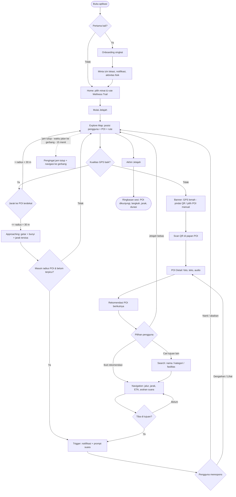
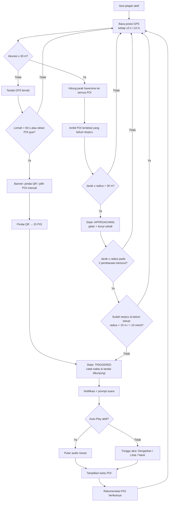
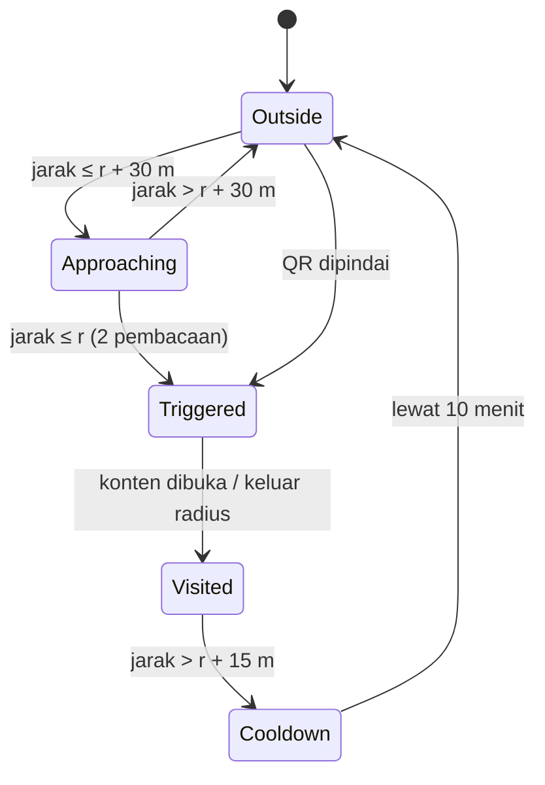

# PRODUCT REQUIREMENTS DOCUMENT (PRD)

## Jelajah Taman — Aplikasi Pemandu Eksplorasi Berbasis Lokasi
### Studi Kasus: Taman Hutan Raya Ir. H. Djuanda (Tahura Djuanda), Zona Dago Pakar, Bandung

**Mata Kuliah:** [Kode MK] Transformasi Digital
**Dosen Pengajar:** Prof. Ir. Kridanto Surendro, M.Sc., Ph.D.
**Topik:** Topik 7 — Public Park & Wellness Explorer

**Disusun Oleh: Kelompok 5**

| No. | Nama Anggota | NIM | Peran |
|---|---|---|---|
| 1 | Jacob Reinhard Marudut Siagian | 18223026 | Project Manager / Scrum Master |
| 2 | Keane Putra Lim | [NIM] | Business Analyst |
| 3 | Michael Dimas Sarono | [NIM] | UX/UI Designer |
| 4 | Michael Ballard Silaen | [NIM] | Developer |
| 5 | M Khalfani Shaquille Indrajaya | [NIM] | Quality Assurance |

PROGRAM STUDI SISTEM DAN TEKNOLOGI INFORMASI
SEKOLAH TEKNIK ELEKTRO DAN INFORMATIKA
INSTITUT TEKNOLOGI BANDUNG
2026

> **Status dokumen:** Draft v0.9 (W9) — menuju baseline v1.0.
> Penanda **[VERIFIKASI]** = data yang harus dikonfirmasi dari survei lapangan / pengelola sebelum baseline disetujui.
> Penanda **[ISI]** = data administratif yang belum tersedia.

---

## 1. Product Definition

### 1.1 Problem Statement

Taman Hutan Raya Ir. H. Djuanda (Tahura Djuanda) merupakan kawasan konservasi seluas ±590 ha yang memiliki banyak objek bernilai sejarah, alam, dan rekreasi—seperti Gua Jepang, Gua Belanda, Monumen Ir. H. Djuanda, kawasan pinus, dan penangkaran rusa—yang tersebar di sepanjang jalur hutan berkontur. Saat ini, informasi bagi pengunjung masih bergantung pada rambu fisik yang jumlahnya sedikit, berukuran kecil, dan minim muatan sejarah maupun informasi alam. Akibatnya, pengunjung—terutama pengunjung baru—sering harus bertanya kepada petugas, berisiko salah jalur, tidak dapat memperkirakan waktu dan tenaga yang dibutuhkan, serta cenderung hanya mengunjungi satu titik karena tidak mengetahui objek lain dan rute menuju ke sana. Kondisi ini membuat nilai edukasi dan potensi wisata kesehatan (berjalan kaki/trekking) kawasan tidak termanfaatkan secara optimal.

Masalah ini penting karena berdampak langsung pada keselamatan pengunjung di kawasan hutan, kualitas pengalaman kunjungan, dan pemerataan kunjungan antar-objek. Teknologi mobile berbasis lokasi membuka peluang transformasi digital: rambu statis dapat diubah menjadi **pemandu kontekstual** yang secara otomatis menyajikan informasi ketika pengguna mendekati suatu objek, menjawab pertanyaan "apa ini, bagaimana ke sana, dan berapa lama", dapat digunakan tanpa terus menatap layar melalui audio, tetap berfungsi tanpa sinyal (offline), serta mendorong aktivitas fisik yang terukur sesuai semangat *public park & wellness*.

### 1.2 Target User/Stakeholder

| Target User / Stakeholder | Karakteristik | Kebutuhan Utama |
|---|---|---|
| **Pengunjung baru** (wisatawan lokal/luar kota, usia remaja–dewasa) | Belum mengenal kawasan; membawa ponsel; datang untuk rekreasi singkat (2–4 jam); sinyal seluler tidak stabil di dalam hutan | Mengetahui objek apa saja yang ada, cara menujunya, dan estimasi waktu; tidak tersesat; mendapatkan cerita singkat di tiap objek |
| **Keluarga dengan anak** | Bergerak lebih lambat; butuh fasilitas (toilet, musala, warung, tempat istirahat); perhatian terbagi untuk mengawasi anak | Rute santai yang realistis; lokasi fasilitas; informasi berbentuk audio agar tidak harus membaca layar sambil mengawasi anak |
| **Mahasiswa/pelajar** (kunjungan edukasi) | Melek teknologi; tertarik pada sejarah dan flora-fauna; sering datang berkelompok | Konten sejarah dan alam yang ringkas namun akurat; kemampuan mencari objek tertentu |
| **Pejalan kaki / hiker / pengunjung rutin wellness** | Datang untuk olahraga; terbiasa berjalan jauh; peduli jarak, durasi, dan tingkat kesulitan | Pilihan rute berdasarkan jarak/tingkat kesulitan; pencatatan langkah, jarak, dan durasi; pengingat istirahat dan hidrasi |
| **Pengelola Tahura** (UPTD Tahura, Dinas Kehutanan Provinsi Jawa Barat) — *stakeholder* | Bertanggung jawab atas informasi, keselamatan, dan izin di kawasan; sumber daya rambu fisik terbatas | Penyebaran informasi kawasan yang akurat tanpa menambah rambu fisik; mengurangi pengunjung tersesat; pengunjung keluar sebelum jam tutup; konten dapat diperbarui |
| **Petugas lapangan** — *stakeholder* | Sering menjawab pertanyaan berulang dari pengunjung | Berkurangnya pertanyaan rutin ("di mana gua?", "berapa jauh?") |

> Catatan lingkup: fitur khusus admin/pengelola (CMS) **tidak** dibangun pada versi ini (lihat NG04). Kebutuhan pengelola dipenuhi melalui data konten POI terstruktur (JSON) yang dapat diperbarui tanpa mengubah kode.

### 1.3 Proposed Product

**Jelajah Taman** adalah aplikasi mobile pemandu eksplorasi berbasis lokasi yang membantu **pengunjung Tahura Djuanda zona Dago Pakar** untuk **menemukan, memahami, dan menjelajahi objek-objek wisata sejarah dan alam secara mandiri dan sehat** melalui **peta POI offline, pemicu informasi otomatis berbasis geofencing GPS (dengan cadangan QR code di gua dan area bersinyal GPS lemah), narasi audio yang dapat dinikmati tanpa menatap layar, pencarian dan navigasi antar-POI di jalur hutan, rekomendasi objek berikutnya yang mempertimbangkan jarak dan sisa waktu sebelum jam tutup, serta mode Wellness Trail yang mencatat langkah, jarak, dan durasi**, sehingga **pengunjung tidak tersesat, mengunjungi lebih banyak objek dengan pemahaman yang lebih baik, dapat merencanakan waktu dan tenaga, serta selesai menjelajah sebelum kawasan tutup.**

### 1.4 Product Goals & Non-Goals

| Product Goals | Non-Goals |
|---|---|
| **G01.** Menyajikan informasi POI (teks, foto, audio) secara otomatis berdasarkan lokasi pengguna saat menjelajah zona Dago Pakar. | **NG01.** Aplikasi tidak menggantikan sistem tiket/pembayaran masuk Tahura. |
| **G02.** Membantu pengunjung menemukan dan menuju POI yang diinginkan melalui pencarian dan navigasi di jalur hutan, termasuk dalam kondisi tanpa sinyal seluler (offline). | **NG02.** Versi awal tidak mencakup seluruh kawasan Tahura (±590 ha); hanya zona Dago Pakar (gerbang Dago Pakar s.d. area Gua Belanda–Gua Jepang). |
| **G03.** Memungkinkan eksplorasi *eyes-free*: informasi dan arahan dapat diterima melalui audio dan getaran tanpa terus menatap layar. | **NG03.** Versi awal tidak menyediakan Augmented Reality, beacon/BLE, atau computer vision. |
| **G04.** Mendorong pengunjung mengunjungi lebih banyak objek melalui rekomendasi POI berikutnya yang realistis terhadap jarak dan sisa waktu kunjungan. | **NG04.** Tidak ada CMS/dashboard admin; pembaruan konten dilakukan melalui file data POI. |
| **G05.** Mendukung aspek *wellness*: pengunjung dapat memilih rute sesuai kemampuan dan memantau aktivitas fisiknya (langkah, jarak, durasi, istirahat). | **NG05.** Tidak ada akun pengguna, login, fitur sosial, atau penyimpanan data pribadi di server. |
| **G06.** Meningkatkan keselamatan dengan pengingat jam tutup kawasan dan informasi titik fasilitas. | **NG06.** Aplikasi bukan alat darurat/SOS dan tidak menggantikan petugas; tidak ada pelacakan real-time oleh pengelola. |
| | **NG07.** Tidak ada pemesanan pemandu, reservasi, atau transaksi apa pun. |
| | **NG08.** Konten hanya Bahasa Indonesia pada versi awal (Bahasa Inggris sebagai pengembangan lanjutan). |

---

## 2. User Experience Scenario

### 2.1 Main Exploration Scenario

**Persona:** Rina (21 tahun), mahasiswi asal Jakarta, berkunjung ke Tahura Djuanda bersama dua temannya pada hari Sabtu pukul 10.30. Ini kunjungan pertamanya. Sinyal seluler di dalam kawasan hilang-timbul.

1. **Start.** Di area parkir, Rina mengunduh Jelajah Taman (data peta dan konten POI sudah termuat penuh saat instalasi). Saat dibuka pertama kali, aplikasi menampilkan onboarding singkat dan meminta izin lokasi, notifikasi, dan aktivitas fisik. Rina memilih minat **"Sejarah"** dan **"Alam"**, lalu memilih rute **"Santai — ±2,5 km, ±2 jam, mudah" [VERIFIKASI]** dari tiga pilihan rute Wellness Trail. Aplikasi menampilkan estimasi bahwa rute dapat selesai sebelum jam tutup 16.00.
2. **Explore.** Rina menekan **"Mulai Jelajah"**. Peta offline menampilkan posisinya (titik biru), jalur rute yang dipilih, dan marker POI. Penghitung langkah dan durasi mulai berjalan. Rina memasukkan ponsel ke saku dan memakai earphone.
3. **Location Trigger.** Saat Rina berjalan mendekati Gua Jepang (±50 m), ponsel bergetar singkat dan terdengar bunyi penanda. Ketika ia masuk radius 20 m, muncul notifikasi (juga terdengar melalui suara): *"Anda tiba di Gua Jepang. Ingin mendengar sejarahnya?"*
4. **Information.** Rina menekan tombol **"Dengarkan"** pada notifikasi tanpa membuka aplikasi. Narasi audio ±90 detik diputar tentang latar belakang pembangunan gua. Setelah itu ia membuka layar dan melihat kartu POI berisi foto, teks singkat, tahun pembangunan, dan estimasi lama kunjungan. Di dalam gua, GPS melemah; aplikasi menampilkan saran *"Sinyal GPS lemah — pindai QR di papan untuk info lorong gua"*. Rina memindai QR (atau memilih POI secara manual) dan konten tetap tampil tanpa internet.
5. **Recommendation.** Setelah keluar dari gua, aplikasi menampilkan **"Berikutnya: Gua Belanda — 650 m, ±12 menit jalan [VERIFIKASI]"** beserta dua alternatif, karena Gua Belanda belum dikunjungi, sesuai minat "Sejarah", dan masih cukup waktu sebelum jam tutup.
6. **Search Destination.** Teman Rina perlu ke toilet. Rina membuka pencarian, mengetik "toilet", dan mendapat daftar fasilitas terdekat dengan jaraknya.
7. **Navigation.** Rina memilih toilet terdekat lalu menekan **"Navigasi"**. Aplikasi menggambar jalur di atas jalan setapak, menampilkan sisa jarak dan estimasi waktu, dan memberi arahan suara di persimpangan (*"Di pertigaan, ambil jalur kiri menurun"*). Saat tiba, aplikasi mengumumkan kedatangan.
8. **Lanjut eksplorasi & pengingat.** Rina melanjutkan ke Gua Belanda mengikuti rekomendasi. Pukul 14.45, aplikasi mengingatkan: *"Kawasan tutup pukul 16.00. Waktu jalan ke gerbang ±25 menit."* Aplikasi juga mengingatkan minum air setelah 45 menit berjalan.
9. **Selesai.** Di gerbang, Rina menekan **"Akhiri Jelajah"**. Aplikasi menampilkan ringkasan: 6 dari 10 POI dikunjungi, 4.820 langkah, 3,1 km, durasi 2 jam 40 menit, serta POI yang belum dikunjungi untuk kunjungan berikutnya.

### 2.2 Main User Flow



> Diagram di atas akan digambar ulang oleh UX Designer (Figma/draw.io) untuk dokumen final; versi Mermaid ini menjadi acuan logika alur.

---

## 3. Product Requirements - Baseline

| ID | Requirement | Deskripsi Implementasi | Priority | Acceptance Criteria |
|---|---|---|---|---|
| **F01** | Location Awareness | Aplikasi meminta izin lokasi, membaca posisi pengguna menggunakan GPS perangkat (mode akurasi tinggi) dengan pembaruan setiap ±3 detik atau setiap perpindahan ≥3 m, lalu menampilkannya sebagai titik biru beserta lingkaran akurasi pada peta offline zona Dago Pakar. Pembacaan dengan akurasi lebih buruk dari 30 m ditandai "GPS lemah" dan tidak dipakai untuk pemicu. Lokasi tetap dibaca saat layar mati selama sesi jelajah aktif (foreground service). | Must | (1) Setelah izin diberikan, posisi pengguna tampil di peta ≤10 detik di area terbuka. (2) Posisi diperbarui saat penguji berjalan 20 m (TC-01). (3) Deviasi posisi terhadap titik referensi survei ≤15 m pada ≥80% pengukuran di area terbuka. (4) Jika izin ditolak, aplikasi menampilkan penjelasan dan tetap dapat dipakai melalui pemilihan POI manual/QR. (5) Indikator "GPS lemah" muncul ketika akurasi >30 m. |
| **F02** | Location-Based Trigger | Setiap POI memiliki titik pusat dan radius pemicu (20–40 m, ditentukan uji lapangan). Aplikasi menghitung jarak pengguna ke setiap POI (haversine). Status POI: *Outside → Approaching* (≤ radius + 30 m) *→ Inside/Triggered* (≤ radius pada 2 pembacaan berturut-turut). Pemicu hanya terjadi sekali per kunjungan; POI baru dapat terpicu lagi setelah pengguna keluar sejauh radius + 15 m (histeresis) **dan** lewat jeda 10 menit. Jika beberapa POI tumpang tindih, POI terdekat dipicu lebih dulu. POI di dalam gua menggunakan QR code sebagai pemicu cadangan. | Must | (1) Ketika penguji memasuki radius POI, notifikasi POI yang benar muncul ≤10 detik pada ≥8 dari 10 POI yang diuji (TC-02). (2) Selama penguji tetap/berputar di dalam radius selama 3 menit, notifikasi tidak muncul ulang (TC-03). (3) Setelah keluar >radius + 15 m dan masuk kembali sebelum 10 menit, tidak ada pemicu ulang. (4) Getaran "approaching" muncul ketika jarak ≤ radius + 30 m. (5) Pemindaian QR membuka POI yang benar dalam ≤3 detik tanpa internet (TC-04). |
| **F03** | Multimodal Exploration | Setiap POI menyajikan konten dalam beberapa modalitas: (a) foto (1–3 foto asli hasil survei), (b) teks ringkas 80–150 kata + fakta kunci (tahun, ketinggian/jarak, kategori), (c) narasi audio 60–120 detik yang direkam tim (fallback: Text-to-Speech jika rekaman belum tersedia), (d) estimasi lama kunjungan. Semua konten tersimpan lokal sehingga dapat diakses tanpa internet. | Must | (1) 10 POI inti memiliki teks, ≥1 foto, dan audio (TC-05). (2) Audio dapat diputar, dijeda, dilanjutkan, dan diulang dari layar POI Detail. (3) Konten tampil lengkap dalam mode pesawat (offline). (4) Waktu buka POI Detail dari notifikasi ≤2 detik. |
| **F04** | Eyes-Free Interaction | Aplikasi dapat digunakan tanpa terus menatap layar: (a) getaran + bunyi penanda saat mendekati POI, (b) prompt suara saat terpicu ("Anda tiba di …, ingin mendengar sejarahnya?"), (c) opsi **Auto-Play Audio** agar narasi langsung diputar setelah pemicu, (d) tombol aksi pada notifikasi dan kontrol media di layar kunci/earphone (play/pause), (e) arahan navigasi melalui suara (TTS) di persimpangan dan saat tiba, (f) pengingat jam tutup dan hidrasi juga disampaikan melalui suara. | Must | (1) Dengan layar terkunci dan ponsel di saku, penguji dapat menerima pemicu, mendengar narasi, dan menjeda/melanjutkan audio melalui notifikasi/earphone tanpa membuka aplikasi (TC-06). (2) Saat Auto-Play aktif, narasi mulai ≤3 detik setelah pemicu. (3) Arahan suara navigasi terdengar di setiap simpul belokan pada rute uji. (4) Pada uji usability, ≥4 dari 5 responden dapat menyelesaikan satu kunjungan POI tanpa melihat layar. |
| **F05** | Search & Destination | Pengguna dapat mencari POI dan fasilitas berdasarkan nama (pencocokan sebagian, tidak peka huruf besar/kecil, toleran salah ketik ringan) dan menyaring berdasarkan kategori (Sejarah, Alam/Flora-Fauna, Rekreasi/Wellness, Fasilitas). Hasil diurutkan menurut jarak jalan kaki dari posisi pengguna dan menampilkan jarak serta estimasi waktu. Memilih hasil membuka detail atau langsung memulai navigasi. | Must | (1) Kata kunci "gua" menampilkan Gua Jepang dan Gua Belanda; "toilet" menampilkan fasilitas toilet (TC-07). (2) Filter kategori hanya menampilkan item kategori tersebut. (3) Hasil berurutan berdasarkan jarak jalan kaki dan menampilkan jarak + ETA. (4) Pencarian berjalan offline dengan hasil ≤1 detik. (5) Kata kunci yang tidak ditemukan menampilkan pesan dan saran kategori. |
| **F06** | Navigation | Navigasi pejalan kaki antar-POI menggunakan **graf jalur setapak** yang dipetakan dari rekaman GPS survei (simpul = persimpangan/POI, sisi = segmen jalur dengan jarak dan kenaikan elevasi). Rute terpendek dihitung dengan algoritma Dijkstra, ditampilkan sebagai garis di peta offline, beserta sisa jarak, ETA (kecepatan dasar 3 km/jam + koreksi tanjakan), arah tujuan, dan arahan suara di persimpangan. Status "tiba" ketika pengguna ≤15 m dari tujuan; jika menyimpang >30 m dari jalur, rute dihitung ulang. | Must | (1) Rute dari posisi pengguna ke POI tujuan mengikuti jalur setapak (bukan garis lurus) dan tampil ≤3 detik (TC-08). (2) Sisa jarak dan ETA berkurang saat pengguna berjalan menuju tujuan. (3) Penguji dapat mencapai 3 POI tujuan berbeda hanya dengan mengikuti navigasi. (4) Rute dihitung ulang ≤5 detik setelah penyimpangan >30 m. (5) Navigasi berfungsi dalam mode pesawat. (6) Selisih ETA vs. waktu tempuh aktual ≤25% pada rute uji. |
| **F07** | Contextual Recommendation | Setelah pengguna selesai di sebuah POI (menutup POI Detail atau keluar dari radius), aplikasi merekomendasikan POI berikutnya. Kandidat = POI yang belum dikunjungi. Kandidat disaring agar *waktu jalan ke POI + lama kunjungan + waktu jalan POI → gerbang ≤ sisa waktu sebelum jam tutup − 15 menit*. Kandidat diurutkan dengan skor: kedekatan jarak jalan (bobot tertinggi), kesesuaian minat yang dipilih, kesesuaian rute Wellness Trail aktif, dan tingkat kesulitan. Ditampilkan 1 rekomendasi utama + 2 alternatif beserta alasannya (mis. "terdekat • sesuai minat Sejarah"). Jika waktu tidak cukup, rekomendasi berubah menjadi "Kembali ke gerbang". | Must | (1) POI yang direkomendasikan selalu belum dikunjungi pada sesi tersebut (TC-09). (2) Rekomendasi muncul ≤2 detik setelah pengguna menyelesaikan POI. (3) Tidak ada POI yang direkomendasikan jika estimasi selesainya melewati jam tutup − 15 menit; pada simulasi waktu 15.30 aplikasi merekomendasikan kembali ke gerbang (TC-10). (4) Mengubah minat mengubah urutan rekomendasi pada skenario uji. (5) Rekomendasi dapat langsung dinavigasi dengan satu ketukan. |
| **F08** | Domain-Specific Innovative Feature: **Wellness Trail Explorer** | Mode jelajah sehat khas kawasan hutan: (a) 3 pilihan rute bertanda tingkat kesulitan (Santai / Sedang / Trekking) dengan jarak, kenaikan elevasi, estimasi durasi, dan daftar POI yang dilalui (hasil pengukuran survei), (b) pencatatan aktivitas selama sesi: langkah (sensor pedometer), jarak tempuh (GPS), durasi, dan estimasi kalori, (c) penanda titik istirahat & fasilitas di peta, (d) pengingat hidrasi/istirahat berkala (default setiap 45 menit, dapat diatur), (e) ringkasan sesi di akhir jelajah (POI dikunjungi, langkah, jarak, durasi, POI yang belum dikunjungi), (f) konten flora-fauna di POI alam (pinus, rusa) sebagai unsur edukasi lingkungan. | Must | (1) Tiga rute tampil dengan jarak, elevasi, durasi, dan tingkat kesulitan (TC-11). (2) Selisih jumlah langkah aplikasi vs. hitungan manual ≤10% pada uji 200 langkah (TC-12). (3) Pengingat hidrasi muncul (suara + notifikasi) sesuai interval yang diatur. (4) Ringkasan sesi menampilkan seluruh metrik dan daftar POI yang dikunjungi sesuai log sesi. (5) Data aktivitas hanya tersimpan di perangkat. |

### 3.1 Additional Requirements (Optional)

| ID | Requirement | Deskripsi | Priority | Acceptance Criteria |
|---|---|---|---|---|
| **A01** | Offline Mode | Peta zona (tile offline), data POI, foto, audio, dan graf jalur dikemas di dalam aplikasi atau diunduh sekali di awal, sehingga seluruh fitur inti berfungsi tanpa internet. | Must | Setelah instalasi/unduhan awal, alur F01–F08 dapat diselesaikan dalam mode pesawat (TC-13). |
| **A02** | QR Fallback Trigger | Papan QR (cetak, dipasang sementara saat uji bila izin permanen belum ada) di mulut/dalam gua dan titik GPS lemah. QR berisi ID POI (mis. `jelajahtaman://poi/P05`) dan dipindai melalui pemindai di dalam aplikasi. | Must | QR setiap POI gua membuka POI yang benar ≤3 detik offline; QR yang tidak dikenal menampilkan pesan error (TC-04). |
| **A03** | Closing-Time Reminder | Aplikasi menghitung waktu jalan dari posisi pengguna ke gerbang dan mengingatkan ketika *jam tutup − waktu jalan ke gerbang − 15 menit* tercapai, disertai opsi navigasi ke gerbang. Jam operasional disimpan sebagai data yang dapat diubah. | Should | Pada simulasi waktu, pengingat muncul (suara + notifikasi) tepat pada ambang yang dihitung (TC-10). |
| **A04** | Facility Finder | Fasilitas (toilet, musala, warung, tempat istirahat, pos petugas) tampil sebagai marker tersendiri dan dapat dicari/dinavigasi, tetapi tidak memicu notifikasi otomatis. | Should | Fasilitas muncul pada pencarian dan filter "Fasilitas", dan tidak memicu notifikasi saat dilewati. |
| **A05** | Data-Driven Content | Seluruh data POI, rute, dan jam operasional dibaca dari file JSON terstruktur; mengubah konten tidak memerlukan perubahan kode. | Should | Mengubah teks/radius satu POI di file data tercermin di aplikasi setelah build ulang/muat ulang data tanpa mengubah kode sumber. |
| **A06** | Battery-Aware Tracking | Selama sesi, interval GPS disesuaikan (lebih jarang saat pengguna diam) untuk menghemat baterai. | Could | Pemakaian baterai ≤15% per jam sesi jelajah pada perangkat uji. |
| **A07** | Accessibility | Ukuran teks dapat diperbesar, kontras memadai, tombol utama ≥48 dp, label pembaca layar untuk tombol utama. | Could | Lulus pemeriksaan Accessibility Scanner tanpa isu kritis pada layar utama. |

---

## 4. Point of Interest (POI) & Location-Trigger Design

### 4.1 POI Definition

Zona studi: **gerbang Dago Pakar s.d. area Gua Belanda–Gua Jepang** [VERIFIKASI batas final dari survei]. Terdapat **10 POI inti** yang memicu konten, **1 POI opsional**, dan **titik fasilitas** yang tidak memicu notifikasi.

| POI ID | Nama POI | Kategori | Lokasi/Koordinat | Content | Trigger Rule | System Response |
|---|---|---|---|---|---|---|
| P01 | Gerbang Dago Pakar | Titik Masuk / Informasi | [lat, lng — VERIFIKASI] | Teks sambutan, peta zona, jam buka, tata tertib, audio sambutan | Masuk radius 30 m (sekali per sesi) | Pesan selamat datang + tawaran memulai sesi & memilih rute Wellness Trail |
| P02 | Monumen Ir. H. Djuanda | Sejarah | [lat, lng — VERIFIKASI] | Teks profil Ir. H. Djuanda & alasan penamaan Tahura, foto monumen, audio narasi | Masuk radius 25 m | Notifikasi + prompt suara "Ingin mendengar kisah Ir. H. Djuanda?" → kartu POI + audio |
| P03 | Museum Ir. H. Djuanda | Sejarah / Edukasi | [lat, lng — VERIFIKASI] | Teks ringkas isi museum, jam buka museum, foto, audio | Masuk radius 25 m | Notifikasi + kartu POI; info jam buka museum |
| P04 | Kolam Pakar | Alam / Lanskap | [lat, lng — VERIFIKASI] | Teks asal-usul & fungsi kolam, foto, audio | Masuk radius 30 m | Notifikasi + kartu POI + audio |
| P05 | Gua Jepang | Sejarah | [lat, lng mulut gua — VERIFIKASI] | Teks sejarah pembangunan & fungsi gua, struktur lorong, fakta kunci, foto, audio, tips keselamatan (senter) | Masuk radius 20 m di mulut gua; **QR** di mulut/dalam gua (GPS lemah) | Getar + prompt suara "Anda tiba di Gua Jepang. Ingin mendengar sejarahnya?" → audio; di dalam gua: banner pindai QR |
| P06 | Gua Belanda | Sejarah | [lat, lng mulut gua — VERIFIKASI] | Teks sejarah gua (terowongan air/PLTA & fungsi militer), fakta kunci, foto, audio, tips keselamatan | Masuk radius 20 m di mulut gua; **QR** di mulut/dalam gua | Sama seperti P05 |
| P07 | Penangkaran Rusa | Fauna | [lat, lng — VERIFIKASI keberadaan & lokasi] | Teks spesies rusa, perilaku, etika (tidak memberi makan sembarangan), foto, audio | Masuk radius 30 m | Notifikasi + kartu POI + audio; pesan etika satwa |
| P08 | Kawasan Hutan Pinus | Flora / Wellness | [lat, lng titik pusat — VERIFIKASI] | Teks tentang pinus & manfaat udara hutan, foto, audio; penanda titik istirahat | Masuk radius 40 m (area luas) | Notifikasi + kartu POI; saran istirahat/hidrasi |
| P09 | Area Rumput / Piknik | Rekreasi / Wellness | [lat, lng — VERIFIKASI] | Teks fasilitas area, aturan kebersihan, foto, audio singkat | Masuk radius 40 m | Notifikasi ringan + kartu POI; opsi "tandai sebagai titik istirahat" |
| P10 | Titik Koleksi Flora (jalur tanaman berlabel) | Flora / Edukasi | [lat, lng — VERIFIKASI kandidat saat survei] | Teks jenis tanaman khas Tahura, foto, audio | Masuk radius 25 m | Notifikasi + kartu POI + audio |
| P11 *(opsional)* | Curug Omas | Alam / Trekking | [lat, lng — VERIFIKASI] | Teks curug, jarak & tingkat kesulitan jalur, peringatan keselamatan, foto, audio | Masuk radius 40 m | Notifikasi + kartu POI; hanya tampil pada rute "Trekking" |

**Titik Fasilitas (tidak memicu notifikasi, dapat dicari & dinavigasi):**

| ID | Nama | Kategori | Lokasi/Koordinat | Content |
|---|---|---|---|---|
| FS01 | Toilet [jumlah & lokasi VERIFIKASI] | Fasilitas | [lat, lng] | Nama, jarak, foto opsional |
| FS02 | Musala | Fasilitas | [lat, lng] | Nama, jarak |
| FS03 | Warung / Kios makanan | Fasilitas | [lat, lng] | Nama, jarak |
| FS04 | Pos Petugas / Informasi | Fasilitas | [lat, lng] | Nama, jarak |
| FS05 | Titik istirahat / bangku | Fasilitas | [lat, lng] | Nama, jarak |

**Struktur data POI (rancangan file `pois.json`):**

```json
{
  "id": "P05",
  "name": "Gua Jepang",
  "category": "sejarah",
  "lat": 0.0,
  "lng": 0.0,
  "radius_m": 20,
  "trigger": ["gps", "qr"],
  "qr_code": "jelajahtaman://poi/P05",
  "visit_minutes": 15,
  "text": "…",
  "key_facts": ["…"],
  "images": ["p05_1.jpg", "p05_2.jpg"],
  "audio": "p05.mp3",
  "audio_duration_s": 90,
  "tags": ["sejarah", "gua"],
  "routes": ["santai", "sedang", "trekking"],
  "safety_note": "Bawa senter; lorong gelap dan lembap."
}
```

> **Catatan akurasi konten:** data sejarah (mis. tahun pembangunan gua), jarak jalur, dan ketinggian berbeda antar-sumber. Setiap fakta di narasi harus dirujuk ke sumber resmi (pengelola Tahura / papan informasi lokasi) atau hasil pengukuran survei, dan sumbernya dicatat di lampiran konten. Foto menggunakan dokumentasi tim sendiri untuk menghindari masalah hak cipta.

### 4.2 Location-Trigger Logic

**Diagram alur pemicu lokasi:**



**State per POI:**



**Penjelasan teknologi:**

1. **GPS/Geofencing (utama, area terbuka).** Posisi dibaca dari GNSS perangkat (mode akurasi tinggi) melalui location service. Geofence dihitung **di dalam aplikasi** (jarak haversine ke titik POI), bukan geofencing API sistem, agar ambang radius, histeresis, dan aturan *debounce* dapat dikendalikan dan diuji. Radius awal 20–40 m ditetapkan berdasarkan tipe POI (mulut gua lebih kecil, area luas seperti hutan pinus lebih besar), lalu dikalibrasi melalui uji lapangan karena kanopi pohon dan kontur lembah menurunkan akurasi GPS. Perubahan radius dicatat di Change Log.
2. **Debounce & histeresis.** Pemicu memerlukan 2 pembacaan berturut-turut di dalam radius untuk mencegah pemicu palsu akibat lompatan GPS; pemicu ulang dicegah oleh histeresis (keluar radius + 15 m) dan jeda 10 menit.
3. **QR code (cadangan, gua & area GPS lemah).** Papan QR berisi ID POI dalam format deep link. Dipindai melalui kamera di dalam aplikasi, dicocokkan ke data lokal, sehingga berfungsi offline. Jika izin pemasangan permanen belum diberikan pengelola, QR dicetak dan dipasang sementara hanya saat pengujian [menunggu konfirmasi dosen/pengelola].
4. **Pemilihan manual (cadangan terakhir).** Jika GPS dan QR tidak tersedia, pengguna dapat memilih POI dari daftar "Di sekitar saya" atau dari pencarian.
5. **Pencatatan kunjungan.** Setiap pemicu dicatat (ID POI, waktu, sumber pemicu GPS/QR, akurasi) ke log lokal untuk rekomendasi (F07), ringkasan sesi (F08), dan bukti pengujian.

---

## 5. Low-Fidelity Prototype

### 5.1 Screen/State List

| ID | Screen/State | Tujuan | Related Requirement |
|---|---|---|---|
| UI01 | Onboarding & Permission | Menjelaskan aplikasi dan meminta izin lokasi, notifikasi, aktivitas fisik, kamera | F01, F04, F08 |
| UI02 | Home — Pilih Minat & Rute | Memilih minat (Sejarah/Alam/Wellness) dan rute Wellness Trail beserta jarak, durasi, kesulitan | F07, F08 |
| UI03 | Explore Map — di luar area POI | Menampilkan posisi pengguna, marker POI & fasilitas, rute aktif, statistik sesi | F01, F08, A01 |
| UI04 | Approaching State | Menampilkan banner jarak ke POI terdekat saat mulai mendekati (getar + bunyi) | F02, F04 |
| UI05 | POI Trigger Notification | Memberi tahu pengguna bahwa ia tiba di POI (in-app + notifikasi sistem layar kunci) dengan aksi Dengarkan/Lihat/Nanti | F02, F04 |
| UI06 | POI Detail | Menampilkan foto, teks, fakta kunci, audio player, estimasi lama kunjungan | F03, F04 |
| UI07 | Eyes-Free / Now Playing | Mode audio layar besar & kontrol di layar kunci/earphone | F04 |
| UI08 | Recommendation Sheet | Menampilkan rekomendasi POI berikutnya + 2 alternatif dan alasannya | F07 |
| UI09 | Search | Mencari POI/fasilitas berdasarkan nama & kategori, terurut jarak | F05, A04 |
| UI10 | Navigation | Menampilkan jalur, sisa jarak, ETA, arahan berikutnya + suara | F06, F04 |
| UI11 | Arrived | Konfirmasi tiba di tujuan → masuk ke pemicu POI | F06, F02 |
| UI12 | QR Scanner / GPS Weak | Banner GPS lemah dan pemindai QR untuk gua | F02, A02 |
| UI13 | Closing / Hydration Reminder | Pengingat jam tutup (dengan navigasi ke gerbang) dan pengingat minum/istirahat | A03, F08 |
| UI14 | Session Summary | Ringkasan POI dikunjungi, langkah, jarak, durasi, POI tersisa | F08 |
| UI15 | Settings | Auto-Play audio, interval hidrasi, ukuran teks, unduh data offline | F04, F08, A01, A07 |

### 5.2 Wireframe

Wireframe berikut adalah sketsa low-fidelity untuk acuan; versi final dibuat oleh UX Designer di Figma. Urutan UI03 → UI04 → UI05 → UI06 menunjukkan perubahan kondisi dari **di luar area POI → mendekati POI → menerima pemicu → mengakses informasi**.

**UI02 — Home: Pilih Minat & Rute**
```
┌──────────────────────────────┐
│  Jelajah Taman        [⚙]    │
│  Tahura Djuanda · Dago Pakar │
│  Buka 08.00–16.00 [VERIF.]   │
├──────────────────────────────┤
│  Minat Anda:                 │
│  [✓ Sejarah] [✓ Alam] [ Well]│
├──────────────────────────────┤
│  Pilih Rute:                 │
│  (●) Santai   2,5 km · 2 j   │
│      ▲ mudah · 6 POI         │
│  ( ) Sedang   4 km · 3 j     │
│  ( ) Trekking 6 km · 4 j     │
│      (angka = VERIFIKASI)    │
├──────────────────────────────┤
│  ✔ Selesai sebelum jam tutup │
│  [      MULAI JELAJAH      ] │
└──────────────────────────────┘
```

**UI03 — Explore Map (di luar area POI)**
```
┌──────────────────────────────┐
│ [🔍 Cari POI / fasilitas   ] │
├──────────────────────────────┤
│          ·····(P02)          │
│      ···            (P05)    │
│   (P01)    ◉ Anda   ····     │
│      ···                 (P06)│
│  [WC]       ····(P08)        │
│                              │
│ ● GPS baik (±8 m) · Offline  │
├──────────────────────────────┤
│ 👣 1.240  📏 0,8 km  ⏱ 0:25  │
│ POI 1/6 · Terdekat: Gua      │
│ Jepang 180 m                 │
│ [Daftar POI] [Akhiri Jelajah]│
└──────────────────────────────┘
```

**UI04 — Approaching (≤ radius + 30 m)**
```
┌──────────────────────────────┐
│ ┌──────────────────────────┐ │
│ │ 📳 Mendekati Gua Jepang   │ │
│ │    45 m lagi  ▲ arah depan│ │
│ └──────────────────────────┘ │
│          (P05) ◌◌◌           │
│             ◉ Anda           │
│                              │
├──────────────────────────────┤
│ 👣 1.410  📏 0,9 km  ⏱ 0:29  │
└──────────────────────────────┘
```

**UI05 — POI Trigger Notification (in-app & layar kunci)**
```
┌──────────────────────────────┐       ┌──────────────────────────────┐
│ (peta diredupkan)            │       │ 12:04   🔒                   │
│ ┌──────────────────────────┐ │       │ ┌──────────────────────────┐ │
│ │ 📍 Anda tiba di          │ │       │ │ Jelajah Taman · sekarang │ │
│ │    GUA JEPANG            │ │       │ │ Anda tiba di Gua Jepang. │ │
│ │ [foto kecil]             │ │       │ │ Ingin mendengar sejarah? │ │
│ │ "Ingin mendengar         │ │       │ │ [▶ Dengarkan] [Nanti]    │ │
│ │  sejarahnya?"            │ │       │ └──────────────────────────┘ │
│ │ [▶ Dengarkan] [Lihat]    │ │       │                              │
│ │ [Nanti]                  │ │       │ 🔊 prompt suara diputar      │
│ └──────────────────────────┘ │       └──────────────────────────────┘
└──────────────────────────────┘
```

**UI06 — POI Detail**
```
┌──────────────────────────────┐
│ ←  Gua Jepang      Sejarah   │
├──────────────────────────────┤
│ [   FOTO 1   ][ 2 ][ 3 ]     │
├──────────────────────────────┤
│ ▶ ━━━━━━○──────── 0:32/1:30  │
│ [⏪10] [⏸] [⏩10] [Mode Audio]│
├──────────────────────────────┤
│ Fakta kunci:                 │
│ • Dibangun: [tahun-VERIF.]   │
│ • Lorong: [jumlah-VERIF.]    │
│ • Waktu kunjung: ±15 mnt     │
│ Teks ringkas 80–150 kata ... │
│ ⚠ Bawa senter, lantai licin  │
├──────────────────────────────┤
│ [ Selesai → Lihat berikutnya]│
└──────────────────────────────┘
```

**UI08 — Recommendation Sheet**
```
┌──────────────────────────────┐
│ Berikutnya untuk Anda        │
│ ┌──────────────────────────┐ │
│ │ ★ Gua Belanda            │ │
│ │ 650 m · ±12 mnt · menurun│ │
│ │ terdekat • minat Sejarah │ │
│ │ [  NAVIGASI KE SINI  ]   │ │
│ └──────────────────────────┘ │
│  Alternatif:                 │
│  • Hutan Pinus  400 m · 8 mn │
│  • Penangkaran Rusa 900 m    │
│ Sisa waktu s.d. tutup: 3j 10m│
│ [Jelajah bebas]  [Cari lain] │
└──────────────────────────────┘
```

**UI09 — Search**
```
┌──────────────────────────────┐
│ ← [ toil|                 ✕] │
│ [Semua][Sejarah][Alam]       │
│ [Wellness][Fasilitas ✓]      │
├──────────────────────────────┤
│ 🚻 Toilet Dekat Gerbang      │
│    120 m · ±3 mnt      [➜]   │
│ 🚻 Toilet Area Piknik        │
│    480 m · ±9 mnt      [➜]   │
├──────────────────────────────┤
│ Tidak ketemu? Coba kategori  │
└──────────────────────────────┘
```

**UI10 — Navigation**
```
┌──────────────────────────────┐
│ ↰ 60 m lagi: ambil jalur kiri│
│   (menurun)          🔊      │
├──────────────────────────────┤
│        (Tujuan) ★            │
│          ┊                   │
│          ┊ ← jalur setapak   │
│     ┌────┘                   │
│     ◉ Anda                   │
│                              │
├──────────────────────────────┤
│ Gua Belanda                  │
│ 520 m · ETA ±10 mnt · ▼ 25 m │
│ [Akhiri Navigasi]            │
└──────────────────────────────┘
```

**UI12 — GPS Lemah / QR Scanner**
```
┌──────────────────────────────┐
│ ⚠ Sinyal GPS lemah (±45 m)   │
│ Di dalam gua? Pindai QR pada │
│ papan informasi.             │
├──────────────────────────────┤
│   ┌──────────────────────┐   │
│   │                      │   │
│   │    [ area kamera ]   │   │
│   │                      │   │
│   └──────────────────────┘   │
│ [Pilih POI manual]  [Tutup]  │
└──────────────────────────────┘
```

**UI14 — Session Summary**
```
┌──────────────────────────────┐
│ 🎉 Jelajah Selesai!          │
├──────────────────────────────┤
│ POI dikunjungi   6 / 10      │
│ Langkah          4.820       │
│ Jarak            3,1 km      │
│ Durasi           2 j 40 m    │
│ Est. kalori      ±210 kkal   │
├──────────────────────────────┤
│ Sudah: Gerbang, Monumen,     │
│ Gua Jepang, Gua Belanda, ... │
│ Belum: Penangkaran Rusa, ... │
│ → untuk kunjungan berikutnya │
├──────────────────────────────┤
│ [Kembali ke Home]            │
└──────────────────────────────┘
```

---

## 6. Product Backlog

| Backlog ID | Product Backlog Item | Related Req. | Priority | Acceptance / Done Criteria | Target Sprint |
|---|---|---|---|---|---|
| PB01 | Menyiapkan project aplikasi, struktur folder, repositori Git, dan build ke perangkat uji Android | - | Must | Aplikasi terpasang dan terbuka tanpa crash di ≥2 perangkat uji | S1 |
| PB02 | Mengimplementasikan izin lokasi dan pembacaan current location (akurasi, interval, indikator GPS lemah) | F01 | Must | Lokasi & akurasi terbaca dan diperbarui di perangkat uji; indikator GPS lemah muncul saat akurasi >30 m | S1 |
| PB03 | Survei lapangan: koordinat 10 POI + fasilitas, foto, rekaman jejak GPS jalur (GPX), waktu tempuh & elevasi | F01, F02, F06, F08 | Must | Dataset survei lengkap untuk 10 POI inti + fasilitas tersimpan di repositori | S1 |
| PB04 | Menyusun dataset POI (`pois.json`) dan memuatnya ke aplikasi | F01, F02, A05 | Must | Data 10 POI + fasilitas dapat dibaca dan ditampilkan sebagai daftar di aplikasi | S1 |
| PB05 | Menampilkan peta offline zona Dago Pakar dengan marker POI, fasilitas, dan posisi pengguna | F01, A01, A04 | Must | Peta, marker, dan titik pengguna tampil dalam mode pesawat | S1 |
| PB06 | Membangun mesin geofence (haversine, state Outside/Approaching/Triggered, debounce, histeresis, cooldown) + log kunjungan | F02 | Must | Unit test logika state lulus; pada uji simulasi lokasi, POI terpicu sekali dan tidak berulang | S2 |
| PB07 | Notifikasi pemicu (in-app & sistem/layar kunci) dengan aksi Dengarkan/Lihat/Nanti + getar & bunyi approaching | F02, F04 | Must | Notifikasi muncul saat layar terkunci; aksi notifikasi berfungsi | S2 |
| PB08 | Menulis naskah & merekam audio narasi 10 POI, menyiapkan foto & teks final (beserta sumber) | F03 | Must | 10 POI memiliki teks, ≥1 foto, audio 60–120 detik, dan catatan sumber | S2 |
| PB09 | Layar POI Detail multimodal (galeri foto, teks, fakta kunci, audio player) | F03 | Must | Informasi visual dan audio terintegrasi pada core exploration flow, offline | S2 |
| PB10 | Pemindai QR + generate & cetak QR untuk POI gua; banner GPS lemah & pemilihan POI manual | F02, A02 | Must | QR P05/P06 membuka POI benar ≤3 detik offline | S2 |
| PB11 | Mode eyes-free: Auto-Play, prompt suara TTS, kontrol media layar kunci/earphone, audio latar belakang | F04 | Must | Satu kunjungan POI dapat diselesaikan dengan layar terkunci (TC-06) | S3 |
| PB12 | Membangun graf jalur dari GPX survei (simpul, sisi, jarak, elevasi) | F06, F08 | Must | Graf jalur memuat seluruh POI & fasilitas sebagai simpul terhubung | S3 |
| PB13 | Pencarian POI/fasilitas (nama, kategori, urut jarak jalan) | F05 | Must | Skenario TC-07 lulus offline | S3 |
| PB14 | Navigasi: rute Dijkstra, garis jalur, sisa jarak, ETA, deteksi tiba, hitung ulang saat menyimpang, arahan suara | F06, F04 | Must | Penguji mencapai 3 POI tujuan hanya dengan navigasi (TC-08) | S3 |
| PB15 | Rekomendasi kontekstual (filter waktu tutup, skor jarak/minat/rute, 1 utama + 2 alternatif) | F07 | Must | TC-09 dan TC-10 lulus | S4 |
| PB16 | Wellness Trail: data 3 rute, layar pilih rute, pedometer, jarak, durasi, estimasi kalori | F08 | Must | TC-11 dan TC-12 lulus | S4 |
| PB17 | Pengingat hidrasi/istirahat & pengingat jam tutup (dengan navigasi ke gerbang) | F08, A03 | Should | Pengingat muncul sesuai interval/ambang pada simulasi waktu | S4 |
| PB18 | Ringkasan sesi (POI dikunjungi/belum, metrik aktivitas) + Settings | F08, F04 | Must | Ringkasan sesuai log sesi uji | S4 |
| PB19 | Kalibrasi radius & uji lapangan F01–F08 di Tahura (test log + video) | F01–F08 | Must | Test log lengkap; radius final dicatat di Change Log | S5 |
| PB20 | Usability testing (≥5 responden, task-based + SUS) dan perbaikan prioritas | F03–F08 | Must | Laporan usability; skor SUS ≥68 atau rencana perbaikan terdokumentasi | S5 |
| PB21 | Perbaikan defect, retest, optimasi baterai, build rilis (APK), video produk ≤3 menit | Semua, A06 | Must | Tidak ada defect kritis terbuka; APK & video siap dikumpulkan | S5 |

---

## 7. Sprint Plan

Sprint berlangsung satu minggu. Sprint plan awal dapat disesuaikan selama proyek, tetapi perubahan backlog/requirement harus dapat ditelusuri pada Change Log.

### Sprint 1 - Week 10 (26 Okt – 1 Nov 2026)
**Sprint Goal:** Membangun fondasi aplikasi dan location awareness.
**Target Increment:** Aplikasi dapat dijalankan di perangkat uji, menampilkan peta offline zona Dago Pakar dengan marker 10 POI + fasilitas dan posisi pengguna yang diperbarui secara real-time.

| Backlog ID | Target Output / Evidence |
|---|---|
| PB01, PB02 | Aplikasi dapat dijalankan dan current location terbaca (screenshot/video perangkat uji) |
| PB03 | Dataset survei (koordinat, foto, GPX, waktu tempuh) tersimpan di repositori |
| PB04 | Dataset POI tersedia dan dapat dibaca aplikasi |
| PB05 | Peta offline + marker + titik pengguna tampil dalam mode pesawat |

### Sprint 2 - Week 11 (2 – 8 Nov 2026)
**Sprint Goal:** Membangun POI, location logic, dan location-based trigger.
**Target Increment:** Pengguna yang mendekati/memasuki radius POI menerima getaran, notifikasi, dan dapat membuka POI Detail berisi foto, teks, dan audio; POI gua dapat dipicu via QR.

| Backlog ID | Target Output / Evidence |
|---|---|
| PB06 | Unit test geofence lulus + video uji simulasi lokasi |
| PB07 | Notifikasi pemicu tampil di layar kunci dengan aksi berfungsi |
| PB08 | Naskah, audio, foto, teks 10 POI tersedia beserta sumber |
| PB09 | Informasi visual dan audio terintegrasi dalam core exploration flow |
| PB10 | QR gua tercetak dan teruji offline |

### Sprint 3 - Week 12 (9 – 15 Nov 2026)
**Sprint Goal:** Mengintegrasikan core location-based exploration experience dan menyiapkan Major Progress Review.
**Target Increment:** Alur Start → Explore → Trigger → Information → Search → Navigation dapat didemonstrasikan end-to-end, termasuk mode eyes-free.

| Backlog ID | Target Output / Evidence |
|---|---|
| PB11 | Video satu kunjungan POI dengan layar terkunci |
| PB12 | Graf jalur tervisualisasi di peta |
| PB13 | Pencarian berjalan offline (TC-07) |
| PB14 | Video navigasi ke POI tujuan mengikuti jalur setapak |

### Sprint 4 - Week 13 (16 – 22 Nov 2026)
**Sprint Goal:** Menyelesaikan fitur utama dan integrasi. **Feature Freeze pada akhir Week 13.**
**Target Increment:** Seluruh F01–F08 dan requirement tambahan prioritas Must/Should terimplementasi, termasuk rekomendasi kontekstual dan Wellness Trail.

| Backlog ID | Target Output / Evidence |
|---|---|
| PB15 | Rekomendasi tampil setelah POI; simulasi waktu 15.30 merekomendasikan kembali ke gerbang |
| PB16 | Tiga rute tampil; uji 200 langkah tercatat |
| PB17 | Pengingat hidrasi & jam tutup teruji pada simulasi waktu |
| PB18 | Ringkasan sesi sesuai log; Settings berfungsi |

### Sprint 5 - Week 14 (23 – 29 Nov 2026)
**Sprint Goal:** Menguji acceptance criteria, memperbaiki defect, retest, dan menstabilkan produk.
**Target Increment:** Produk stabil yang lulus acceptance criteria F01–F08 di lokasi, dengan bukti pengujian lengkap dan APK rilis.

| Backlog ID | Target Output / Evidence |
|---|---|
| PB19 | Test log uji lapangan TC-01–TC-13 + video field test |
| PB20 | Laporan usability testing + skor SUS |
| PB21 | Daftar defect tertutup, hasil retest, APK rilis, video produk |

### Week 12 - Major Progress Review

Diisi saat review Week 12.

| Item | Isi |
|---|---|
| Sprint Goal | Core location-based exploration (trigger, informasi multimodal, pencarian, navigasi) dapat didemonstrasikan. |
| Planned Backlog | PB06–PB14 |
| Completed Backlog | [diisi W12] |
| Not Done | [diisi W12] |
| Evidence/Demo | [diisi W12 — link video/APK/test log] |
| Blocker & Recovery Plan | [diisi W12] |

---

## 8. Technical & AI-Assisted Development Plan

### 8.1 Proposed Technology

> Usulan awal; dikonfirmasi oleh Developer setelah eksplorasi teknis di awal Sprint 1. Alasan utama: kebutuhan peta & navigasi **offline di jalur hutan** (Google Maps tidak memetakan jalan setapak Tahura dan tidak mendukung routing offline), audio latar belakang, dan lokasi saat layar mati.

| Component | Proposed Technology / Tool | Purpose |
|---|---|---|
| Application | Flutter (Dart) — target Android; alternatif: Android Studio / Kotlin | Pengembangan aplikasi mobile; satu basis kode, prototyping UI cepat |
| Location | `geolocator` (Fused Location Provider di Android) + foreground service | Membaca dan memperbarui lokasi pengguna, termasuk saat layar mati |
| Geofence logic | Logika internal (haversine + state machine) | Pemicu POI dengan radius, debounce, histeresis yang dapat diuji |
| Map | `flutter_map` + tile OpenStreetMap offline (MBTiles zona Dago Pakar, dibuat sendiri; atribusi OSM) | Menampilkan peta, POI, jalur tanpa internet |
| Navigation | Graf jalur dari GPX survei + Dijkstra (implementasi sendiri) | Rute pejalan kaki di jalan setapak, ETA, deteksi tiba |
| Data | JSON lokal (aset aplikasi) + penyimpanan lokal (SharedPreferences/SQLite) untuk log sesi | Data POI, rute, konten; log kunjungan & aktivitas |
| Audio/Multimedia | `just_audio` + `audio_service` (kontrol layar kunci), `flutter_tts` | Narasi audio, prompt suara, arahan navigasi |
| QR | `mobile_scanner` | Pemicu cadangan di gua |
| Notification & Haptics | `flutter_local_notifications`, `vibration` | Notifikasi pemicu, getar approaching |
| Wellness | `pedometer` (Step Counter sensor Android) | Hitung langkah |
| Survey tools | Aplikasi perekam GPX (mis. OsmAnd / GPS Logger), kamera ponsel | Koordinat POI, jejak jalur, elevasi, foto |
| Design | Figma / draw.io | User flow, wireframe, prototype |
| Collaboration | GitHub (repositori & issue), Line, Google Drive | Kode, backlog, dokumentasi |
| AI Development Tool | Claude (Claude Code), ChatGPT / Gemini | Membantu perencanaan, coding, dan debugging |

### 8.2 AI-Assisted Development Plan

| Aktivitas | AI / Tool | Penggunaan yang Direncanakan | Cara Verifikasi |
|---|---|---|---|
| Requirement/Planning | Claude, ChatGPT / Gemini | Membantu menyusun draft struktur PRD, mengkritisi user flow, dan memeriksa kelengkapan & keterujian acceptance criteria | Tim membandingkan hasil dengan kickoff & spesifikasi tugas, memverifikasi fakta lokasi melalui survei/pengelola, dan menyetujui perubahan secara manual dalam rapat tim |
| Content | ChatGPT / Claude | Membantu menyunting naskah audio agar ringkas dan mudah didengar | Seluruh fakta sejarah/alam dicek ke sumber resmi atau papan informasi; tidak ada fakta yang hanya bersumber dari AI |
| UI/Prototype | AI design assistant (mis. Figma AI) | Menghasilkan alternatif wireframe awal | Tim memilih dan menyesuaikan berdasarkan user scenario; diuji pada usability test |
| Coding | Claude Code / Gemini | Membantu scaffolding project, implementasi geofence, Dijkstra, integrasi plugin | Code review oleh anggota lain; unit test untuk logika geofence, rekomendasi, dan routing; developer mampu menjelaskan setiap bagian kode saat demo |
| Debugging | Claude Code / ChatGPT | Menganalisis error log dan perilaku GPS yang tidak stabil | Perbaikan diverifikasi dengan retest pada perangkat dan dicatat di test log |
| Testing | ChatGPT / Claude | Membantu menyusun test case dari acceptance criteria dan skenario usability | QA mengeksekusi test case secara manual di lapangan; hasil aktual dicatat apa adanya |

Seluruh penggunaan AI dicatat dalam **AI & Tools Disclosure / Development Log** (tanggal, tool, tujuan, prompt ringkas, keputusan tim) oleh QA.

**Prinsip:** AI may assist development, but the team remains responsible for understanding, verifying, testing, and demonstrating every implemented feature.

---

## 9. PRD Baseline Approval

Diisi pada akhir Week 9 sebagai gate sebelum pengembangan.

| Baseline Item | Status |
|---|---|
| Product problem clearly defined | ☐ Complete ☐ Revision |
| Target user defined | ☐ Complete ☐ Revision |
| Main user experience defined | ☐ Complete ☐ Revision |
| F01-F08 defined | ☐ Complete ☐ Revision |
| Acceptance criteria testable | ☐ Complete ☐ Revision |
| POI defined | ☐ Complete ☐ Revision |
| Location-trigger mechanism defined | ☐ Complete ☐ Revision |
| User flow completed | ☐ Complete ☐ Revision |
| Low-fi prototype completed | ☐ Complete ☐ Revision |
| Product backlog prepared | ☐ Complete ☐ Revision |
| Sprint 1-5 planned | ☐ Complete ☐ Revision |

**PMO Decision:** ☐ APPROVED ☐ APPROVED WITH REVISION ☐ REVISION REQUIRED

**Catatan PMO:**

---

## 10. Change Log

Setiap perubahan requirement atau backlog penting setelah baseline W9 harus dicatat dan memiliki alasan.

| Version | Date | Requirement / Backlog | Change | Reason | Approval |
|---|---|---|---|---|---|
| 0.9 | W9 (20 Okt 2026) | Seluruh dokumen | Draft PRD disusun dari hasil kick-off W7 | Persiapan workshop PRD W9 | Internal tim |
| 1.0 | W9 | Initial Baseline | Initial PRD | — | [PMO] |

---

## 11. Final Product Compliance - Diisi Week 14-15

Bagian ini sengaja tersedia sejak PRD W9, tetapi baru diisi saat testing/final review.

| Req. | W9 Baseline Requirement | Acceptance Criteria | Final Status | Test Result | Evidence |
|---|---|---|---|---|---|
| F01 | Location Awareness | Posisi tampil ≤10 s, diperbarui saat berjalan, deviasi ≤15 m (≥80%) | ☐ Pass ☐ Partial ☐ Fail | TC-01: | |
| F02 | Location-Based Trigger | Terpicu pada radius yang disetujui (≥8/10 POI), tidak berulang, QR berfungsi | ☐ Pass ☐ Partial ☐ Fail | TC-02, TC-03, TC-04: | |
| F03 | Multimodal Exploration | 10 POI lengkap teks/foto/audio, offline | ☐ Pass ☐ Partial ☐ Fail | TC-05: | |
| F04 | Eyes-Free Interaction | Kunjungan POI selesai dengan layar terkunci; arahan suara | ☐ Pass ☐ Partial ☐ Fail | TC-06: | |
| F05 | Search & Destination | Pencarian nama/kategori, urut jarak, offline | ☐ Pass ☐ Partial ☐ Fail | TC-07: | |
| F06 | Navigation | Rute mengikuti jalur, ETA, tiba, hitung ulang, offline | ☐ Pass ☐ Partial ☐ Fail | TC-08: | |
| F07 | Contextual Recommendation | Rekomendasi POI belum dikunjungi & layak waktu | ☐ Pass ☐ Partial ☐ Fail | TC-09, TC-10: | |
| F08 | Wellness Trail Explorer | 3 rute, pedometer ≤10% error, pengingat, ringkasan | ☐ Pass ☐ Partial ☐ Fail | TC-11, TC-12: | |

---

## 12. Final Deliverables Checklist - Week 15

| Deliverable | Status / Link / Evidence |
|---|---|
| Final Working Product (APK/URL/QR/etc.) | |
| Testing Report | |
| PRD Compliance Matrix | |
| Product Video (max. 3 minutes) | |
| AI & Tools Disclosure / Development Log | |

---

## Lampiran A — Daftar Test Case (rujukan Acceptance Criteria)

| TC ID | Requirement | Skenario Uji | Lokasi/Metode |
|---|---|---|---|
| TC-01 | F01 | Buka aplikasi, berjalan 20 m, bandingkan posisi dengan titik referensi | Lapangan, area terbuka |
| TC-02 | F02 | Masuki radius 10 POI satu per satu; catat POI yang terpicu & waktu | Lapangan |
| TC-03 | F02 | Diam/berputar 3 menit di dalam radius; keluar–masuk sebelum 10 menit | Lapangan |
| TC-04 | F02, A02 | Pindai QR P05/P06 dalam mode pesawat; pindai QR tak dikenal | Lapangan (gua) |
| TC-05 | F03 | Buka 10 POI dalam mode pesawat; periksa teks, foto, audio | Perangkat |
| TC-06 | F04 | Ponsel terkunci di saku + earphone; selesaikan 1 kunjungan POI | Lapangan |
| TC-07 | F05 | Cari "gua", "toilet", kata acak; uji filter kategori, offline | Perangkat |
| TC-08 | F06 | Navigasi ke 3 POI; sengaja menyimpang >30 m; bandingkan ETA vs aktual | Lapangan |
| TC-09 | F07 | Kunjungi 3 POI berurutan; pastikan rekomendasi selalu POI belum dikunjungi | Lapangan/simulasi |
| TC-10 | F07, A03 | Simulasi jam 14.45 dan 15.30; periksa pengingat & rekomendasi kembali ke gerbang | Simulasi waktu |
| TC-11 | F08 | Periksa data 3 rute di layar pilih rute | Perangkat |
| TC-12 | F08 | Jalan 200 langkah dihitung manual; bandingkan dengan pedometer | Lapangan |
| TC-13 | A01 | Jalankan alur F01–F08 penuh dalam mode pesawat | Lapangan |

## Lampiran B — Item yang Harus Diverifikasi Sebelum Baseline v1.0

| No. | Item | Sumber Verifikasi | PIC |
|---|---|---|---|
| 1 | Batas final zona studi dan daftar 10 POI inti (termasuk keberadaan Museum, Kolam Pakar, Penangkaran Rusa, titik koleksi flora) | Survei lapangan | Business Analyst |
| 2 | Koordinat setiap POI & fasilitas | Survei lapangan (GPS) | Business Analyst + Developer |
| 3 | Jarak, elevasi, dan waktu tempuh rute Santai/Sedang/Trekking | Rekaman GPX survei | Business Analyst |
| 4 | Jam operasional (±08.00–16.00) dan tarif masuk | Pengelola Tahura / situs resmi | Project Manager |
| 5 | Fakta sejarah gua (tahun, fungsi, panjang lorong) dan monumen | Pengelola / papan informasi / sumber resmi | Business Analyst |
| 6 | Izin survei dan pemasangan QR (permanen/sementara) | Pengelola (Dinas Kehutanan Provinsi Jawa Barat) | Project Manager |
| 7 | Kesesuaian Tahura & zona Dago Pakar untuk Topik 7, serta penerimaan QR sebagai cadangan | Dosen/asisten | Project Manager |
| 8 | Kualitas sinyal GPS di bawah kanopi, lembah, dan dalam gua (untuk kalibrasi radius) | Uji lapangan awal | QA + Developer |
| 9 | NIM anggota & kode mata kuliah | Tim | Project Manager |
