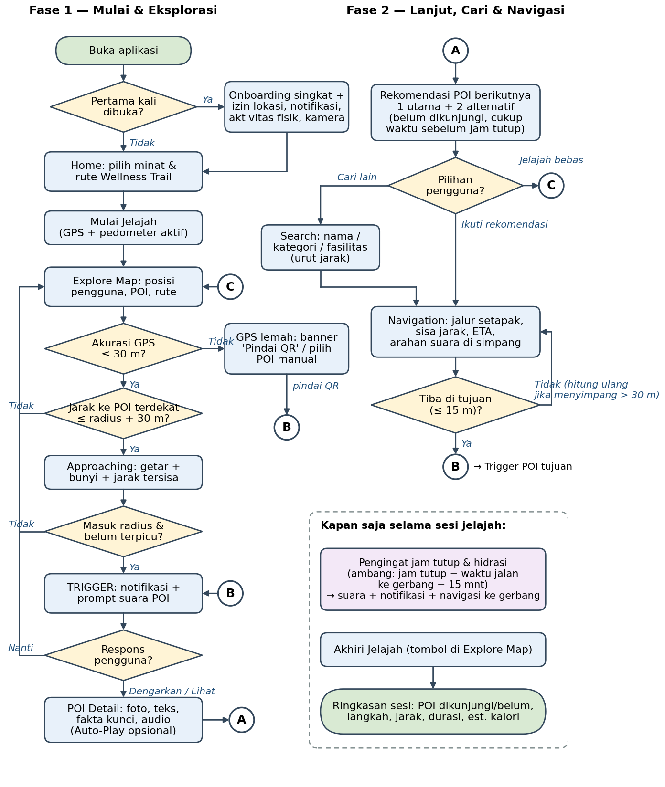
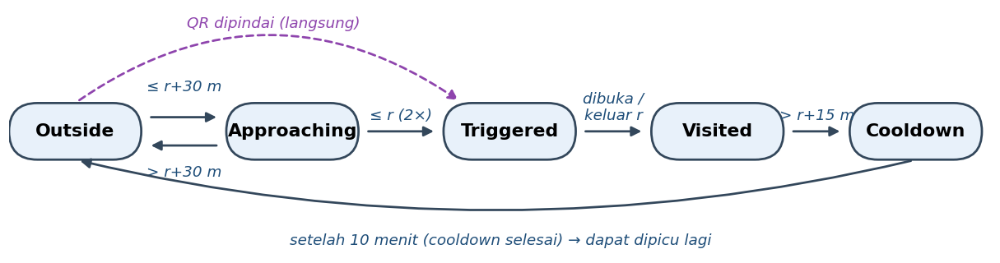
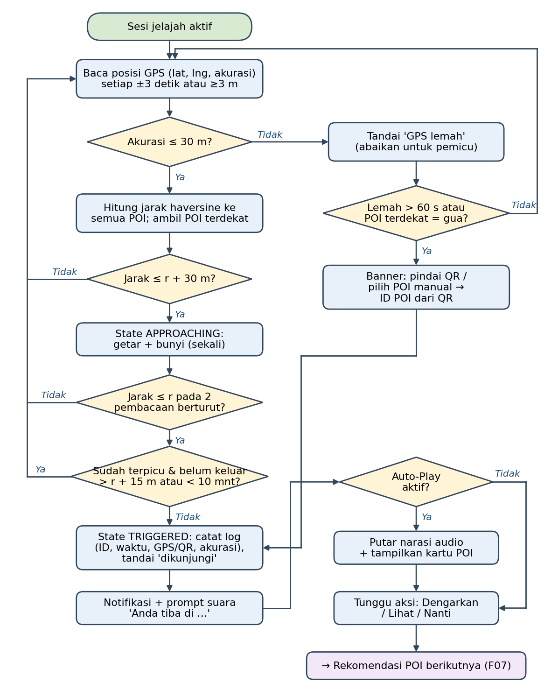
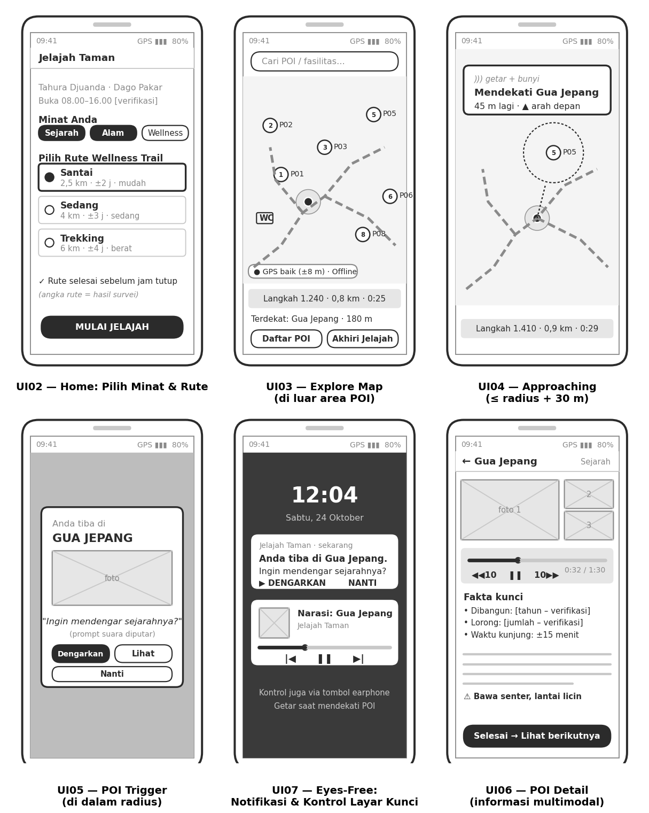
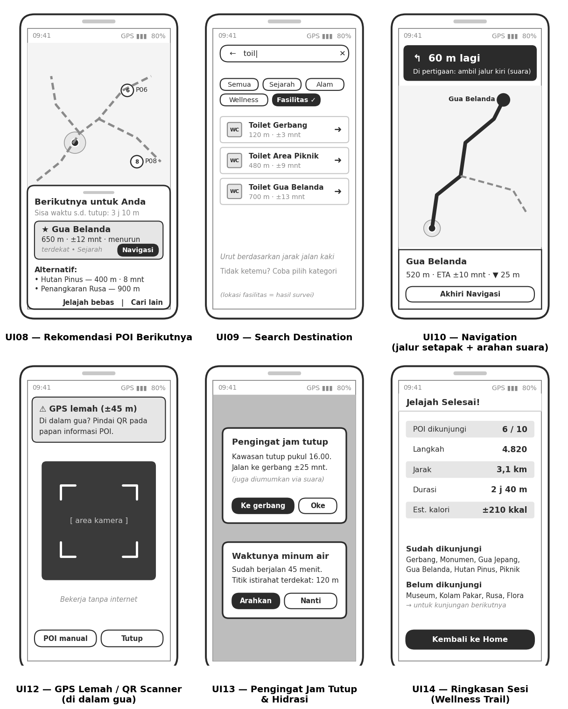

<!-- GENERATED from docs/prd/PRD_Kelompok5_Jelajah_Taman.docx by tools/prd_to_md.py.
     Do not edit by hand: edit the docx, then rerun the script. -->

# PRODUCT REQUIREMENTS DOCUMENT (PRD)

**JELAJAH TAMAN — Aplikasi Pemandu Eksplorasi Berbasis Lokasi**

**Studi Kasus: Taman Hutan Raya Ir. H. Djuanda (Zona Dago Pakar), Bandung**

**Mata Kuliah: [Kode MK] Transformasi Digital**

**Dosen Pengajar: Prof. Ir. Kridanto Surendro, M.Sc., Ph.D.**


**Disusun Oleh:**

**Kelompok 5 — Topik 7: Public Park & Wellness Explorer**

| **No.** | **Nama Anggota** | **NIM** |
|---|---|---|
| 1 | Jacob Reinhard Marudut Siagian | 18223026 |
| 2 | Keane Putra Lim | 18223056 |
| 3 | Michael Dimas Sarono | 18223076 |
| 4 | Michael Ballard Silaen | 18223080 |
| 5 | M Khalfani Shaquille Indrajaya | 18223104 |

**PROGRAM STUDI SISTEM DAN TEKNOLOGI INFORMASI**

**SEKOLAH TEKNIK ELEKTRO DAN INFORMATIKA**

**INSTITUT TEKNOLOGI BANDUNG**

**2026**

## 1. Product Definition

### 1.1 Problem Statement

Taman Hutan Raya Ir. H. Djuanda (Tahura Djuanda) merupakan kawasan konservasi seluas ±590 ha yang memiliki banyak objek bernilai sejarah, alam, dan rekreasi—seperti Gua Jepang, Gua Belanda, Monumen Ir. H. Djuanda, kawasan pinus, dan penangkaran rusa—yang tersebar di sepanjang jalur hutan berkontur. Saat ini informasi bagi pengunjung masih bergantung pada rambu fisik yang jumlahnya sedikit, berukuran kecil, dan minim muatan sejarah maupun informasi alam. Akibatnya, pengunjung—terutama pengunjung baru—sering harus bertanya kepada petugas, berisiko salah jalur, tidak dapat memperkirakan waktu dan tenaga yang dibutuhkan, serta cenderung hanya mengunjungi satu titik karena tidak mengetahui objek lain dan rute menuju ke sana. Nilai edukasi dan potensi wisata sehat (berjalan kaki/trekking) kawasan pun belum termanfaatkan secara optimal.

Masalah ini penting karena berdampak langsung pada keselamatan pengunjung di kawasan hutan, kualitas pengalaman kunjungan, dan pemerataan kunjungan antar-objek. Teknologi mobile berbasis lokasi membuka peluang transformasi digital: rambu statis dapat diubah menjadi **pemandu kontekstual** yang secara otomatis menyajikan informasi ketika pengguna mendekati suatu objek, menjawab pertanyaan "apa ini, bagaimana ke sana, dan berapa lama", dapat digunakan tanpa terus menatap layar melalui audio, tetap berfungsi tanpa sinyal (offline), serta mendorong aktivitas fisik yang terukur sesuai semangat public park & wellness.

### 1.2 Target User/Stakeholder

| Target User | Karakteristik | Kebutuhan Utama |
|---|---|---|
| **Pengunjung baru** (wisatawan lokal/luar kota, usia remaja–dewasa) | Belum mengenal kawasan; membawa ponsel; kunjungan rekreasi singkat (2–4 jam); sinyal seluler tidak stabil di dalam hutan | Mengetahui objek yang ada, cara menujunya, dan estimasi waktu; tidak tersesat; mendapat cerita singkat di tiap objek |
| **Keluarga dengan anak** | Bergerak lebih lambat; butuh fasilitas (toilet, musala, warung, tempat istirahat); perhatian terbagi untuk mengawasi anak | Rute santai yang realistis; lokasi fasilitas; informasi berbentuk audio agar tidak harus membaca layar |
| **Mahasiswa/pelajar** (kunjungan edukasi) | Melek teknologi; tertarik pada sejarah dan flora-fauna; sering datang berkelompok | Konten sejarah dan alam yang ringkas namun akurat; dapat mencari objek tertentu |
| **Pejalan kaki / hiker / pengunjung rutin wellness** | Datang untuk olahraga; terbiasa berjalan jauh; peduli jarak, durasi, dan tingkat kesulitan | Pilihan rute berdasarkan jarak/kesulitan; pencatatan langkah, jarak, durasi; pengingat istirahat dan hidrasi |
| **Pengelola Tahura** (UPTD Tahura, Dinas Kehutanan Provinsi Jawa Barat) — stakeholder | Bertanggung jawab atas informasi, keselamatan, dan izin di kawasan; sumber daya rambu fisik terbatas | Informasi kawasan tersebar akurat tanpa menambah rambu fisik; pengunjung tersesat berkurang; pengunjung keluar sebelum jam tutup; konten dapat diperbarui |
| **Petugas lapangan** — stakeholder | Sering menjawab pertanyaan berulang dari pengunjung | Berkurangnya pertanyaan rutin ("di mana gua?", "berapa jauh?") |

Catatan lingkup: fitur khusus admin/pengelola (CMS) tidak dibangun pada versi ini (NG04). Kebutuhan pengelola dipenuhi melalui data konten POI terstruktur (JSON) yang dapat diperbarui tanpa mengubah kode.

### 1.3 Proposed Product

**Jelajah Taman** adalah aplikasi mobile pemandu eksplorasi berbasis lokasi yang membantu **pengunjung Tahura Djuanda zona Dago Pakar** untuk menemukan, memahami, dan menjelajahi objek wisata sejarah dan alam secara mandiri dan sehat melalui peta POI offline, pemicu informasi otomatis berbasis geofencing GPS (dengan cadangan QR code di gua dan area bersinyal GPS lemah), narasi audio yang dapat dinikmati tanpa menatap layar, pencarian dan navigasi antar-POI di jalur hutan, rekomendasi objek berikutnya yang mempertimbangkan jarak dan sisa waktu sebelum jam tutup, serta mode Wellness Trail yang mencatat langkah, jarak, dan durasi, sehingga pengunjung tidak tersesat, mengunjungi lebih banyak objek dengan pemahaman yang lebih baik, dapat merencanakan waktu dan tenaga, serta selesai menjelajah sebelum kawasan tutup.

### 1.4 Product Goals & Non-Goals

| Product Goals | Non-Goals |
|---|---|
| G01. Menyajikan informasi POI (teks, foto, audio) secara otomatis berdasarkan lokasi pengguna saat menjelajah zona Dago Pakar. | NG01. Aplikasi tidak menggantikan sistem tiket/pembayaran masuk Tahura. |
| G02. Membantu pengunjung menemukan dan menuju POI melalui pencarian dan navigasi di jalur hutan, termasuk tanpa sinyal seluler (offline). | NG02. Versi awal tidak mencakup seluruh kawasan Tahura (±590 ha); hanya zona Dago Pakar (gerbang Dago Pakar s.d. area Gua Belanda–Gua Jepang). |
| G03. Memungkinkan eksplorasi eyes-free: informasi dan arahan diterima melalui audio dan getaran tanpa terus menatap layar. | NG03. Versi awal tidak menyediakan Augmented Reality, beacon/BLE, atau computer vision. |
| G04. Mendorong kunjungan ke lebih banyak objek melalui rekomendasi POI berikutnya yang realistis terhadap jarak dan sisa waktu. | NG04. Tidak ada CMS/dashboard admin; pembaruan konten dilakukan melalui file data POI. |
| G05. Mendukung aspek wellness: pengunjung memilih rute sesuai kemampuan dan memantau aktivitas fisiknya (langkah, jarak, durasi, istirahat). | NG05. Tidak ada akun pengguna, login, fitur sosial, atau penyimpanan data pribadi di server. |
| G06. Meningkatkan keselamatan melalui pengingat jam tutup kawasan dan informasi titik fasilitas. | NG06. Aplikasi bukan alat darurat/SOS dan tidak menggantikan petugas; tidak ada pelacakan real-time oleh pengelola. |
|  | NG07. Tidak ada pemesanan pemandu, reservasi, atau transaksi apa pun. |
|  | NG08. Konten hanya Bahasa Indonesia pada versi awal. |

## 2. User Experience Scenario

### 2.1 Main Exploration Scenario

**Persona:** Rina (21 tahun), mahasiswi asal Jakarta, berkunjung ke Tahura Djuanda bersama dua temannya pada hari Sabtu pukul 13.00. Ini kunjungan pertamanya, dan sinyal seluler di dalam kawasan hilang-timbul.

1. **Start.** Di area parkir, Rina mengunduh Jelajah Taman (data peta dan konten POI ikut terunduh penuh). Saat dibuka pertama kali, aplikasi menampilkan onboarding singkat dan meminta izin lokasi, notifikasi, dan aktivitas fisik. Rina memilih minat "Sejarah" dan "Alam", lalu memilih rute "Santai" (±2,5 km, ±2 jam, mudah). Aplikasi menampilkan bahwa rute dapat selesai sebelum jam tutup 16.00.

2. **Explore.** Rina menekan "Mulai Jelajah". Peta offline menampilkan posisinya, jalur rute, serta marker POI dan fasilitas. Penghitung langkah dan durasi mulai berjalan. Rina memasukkan ponsel ke saku dan memakai earphone.

3. **Location Trigger.** Saat Rina berjarak ±50 m dari Gua Jepang, ponsel bergetar dan berbunyi singkat. Ketika ia masuk radius 20 m, muncul notifikasi sekaligus prompt suara: "Anda tiba di Gua Jepang. Ingin mendengar sejarahnya?"

4. **Information.** Rina menekan "Dengarkan" pada notifikasi tanpa membuka aplikasi; narasi audio ±2,5 menit diputar. Setelah itu ia membuka kartu POI berisi foto, teks singkat, fakta kunci, dan estimasi lama kunjungan. Di dalam gua GPS melemah, sehingga aplikasi menyarankan memindai QR pada papan informasi; konten tetap tampil tanpa internet.

5. **Recommendation.** Setelah keluar dari gua, aplikasi menampilkan "Berikutnya: Gua Belanda — 650 m, ±12 menit" beserta dua alternatif, karena Gua Belanda belum dikunjungi, sesuai minat "Sejarah", dan masih cukup waktu sebelum jam tutup.

6. **Search Destination.** Teman Rina perlu ke toilet. Rina membuka pencarian, mengetik "toilet", dan mendapat daftar fasilitas terdekat beserta jarak dan estimasi waktu jalan.

7. **Navigation.** Rina memilih toilet terdekat lalu menekan "Navigasi". Aplikasi menggambar jalur di atas jalan setapak, menampilkan sisa jarak dan ETA, serta memberi arahan suara di persimpangan ("Di pertigaan, ambil jalur kiri menurun"). Saat tiba, aplikasi mengumumkan kedatangan.

8. **Lanjut eksplorasi dan pengingat.** Rina melanjutkan ke Gua Belanda sesuai rekomendasi. Pukul 15.20 aplikasi mengingatkan: "Kawasan tutup pukul 16.00. Waktu jalan ke gerbang ±25 menit." Aplikasi juga mengingatkan minum air setelah 45 menit berjalan.

9. **Selesai.** Di gerbang, Rina menekan "Akhiri Jelajah". Aplikasi menampilkan ringkasan: 6 dari 10 POI dikunjungi, 4.820 langkah, 3,1 km, durasi 2 jam 40 menit, serta daftar POI yang belum dikunjungi untuk kunjungan berikutnya.

### 2.2 Main User Flow

*Gambar 2.1 menunjukkan urutan interaksi pengguna sejak membuka aplikasi, memulai eksplorasi, terdeteksi lokasinya, mendekati POI, menerima informasi, mencari tujuan lain, menggunakan navigasi, hingga memperoleh rekomendasi berikutnya. Konektor A, B, dan C menghubungkan kedua fase alur.*



*Gambar 2.1 Main user flow aplikasi Jelajah Taman*

## 3. Product Requirements - Baseline

Tabel berikut merupakan baseline requirement F01–F08 yang menjadi dasar penilaian produk akhir. Setiap acceptance criteria dirancang agar dapat diuji dan dirujuk ke test case (TC-xx) pada Lampiran A. Nilai radius dan ambang waktu adalah nilai awal yang dikalibrasi melalui uji lapangan; perubahannya dicatat pada Change Log.

| ID | Requirement | Deskripsi Implementasi | Priority | Acceptance Criteria |
|---|---|---|---|---|
| **F01** | Location Awareness | Aplikasi meminta izin lokasi dan membaca posisi pengguna menggunakan GPS perangkat (akurasi tinggi), diperbarui setiap ±3 detik tanpa filter jarak (agar pengguna yang diam tetap menghasilkan pembacaan untuk konfirmasi pemicu dan deteksi GPS lemah), lalu menampilkannya sebagai titik biru beserta lingkaran akurasi pada peta offline zona Dago Pakar. Pembacaan dengan akurasi >30 m ditandai "GPS lemah" dan tidak dipakai untuk pemicu. Lokasi tetap dibaca saat layar mati selama sesi jelajah aktif (foreground service). | Must | (1) Setelah izin diberikan, posisi tampil ≤10 detik di area terbuka.<br>(2) Posisi diperbarui saat penguji berjalan 20 m (TC-01).<br>(3) Deviasi posisi terhadap titik referensi survei ≤15 m pada ≥80% pengukuran di area terbuka.<br>(4) Jika izin ditolak, aplikasi menjelaskan alasannya dan tetap dapat dipakai via pemilihan POI manual/QR.<br>(5) Indikator "GPS lemah" muncul saat akurasi >30 m. |
| **F02** | Location-Based Trigger | Setiap POI memiliki titik pusat dan radius pemicu (20–40 m, dikalibrasi lewat uji lapangan). Aplikasi menghitung jarak pengguna ke setiap POI (haversine). State POI: Outside → Approaching (≤ radius + 30 m; kembali ke Outside bila > radius + 40 m) → Triggered (≤ radius pada 2 pembacaan berturut-turut) → Visited (pengguna memilih Dengarkan/Lihat, Auto-Play berjalan, POI Detail dibuka, atau QR dipindai; pilihan "Nanti" tidak menandai POI sebagai dikunjungi) → Cooldown. Getaran approaching muncul sekali per pendekatan dan hanya untuk POI yang belum terpicu. Setiap pembacaan mengevaluasi semua POI yang memenuhi syarat, bukan hanya POI terdekat; bila beberapa POI memenuhi syarat pemicu, POI terdekat dipicu lebih dulu. Pemicu terjadi sekali per kunjungan; POI dapat terpicu lagi hanya bila pengguna pernah keluar sejauh radius + 15 m (histeresis) dan sudah lewat 10 menit sejak waktu pemicu. Bila akurasi > 30 m berlangsung 60 detik, aplikasi menampilkan banner untuk memindai QR atau memilih POI secara manual. POI gua memakai QR code sebagai pemicu cadangan. | Must | (1) Saat penguji memasuki radius POI, notifikasi POI yang benar muncul ≤10 detik pada ≥8 dari 10 POI (TC-02).<br>(2) Selama penguji tetap/berputar di dalam radius selama 3 menit, notifikasi tidak muncul ulang (TC-03).<br>(3) Keluar >radius + 15 m lalu masuk kembali sebelum 10 menit tidak memicu ulang.<br>(4) Getaran "approaching" muncul saat jarak ≤ radius + 30 m.<br>(5) Pemindaian QR membuka POI yang benar ≤3 detik tanpa internet (TC-04).<br>(6) Selama TC-02 tidak ada notifikasi untuk POI yang radiusnya tidak dimasuki penguji (tanpa pemicu palsu). |
| **F03** | Multimodal Exploration | Setiap POI menyajikan: (a) 1–3 foto asli hasil survei, (b) teks ringkas 80–150 kata + fakta kunci (tahun, jarak/ketinggian, kategori), (c) narasi audio 120–180 detik yang disuarakan dengan suara sintetis (Gemini TTS) dari naskah tim yang bersumber dan diverifikasi (fallback Text-to-Speech perangkat bila file belum tersedia), (d) estimasi lama kunjungan. Seluruh konten tersimpan lokal sehingga dapat diakses tanpa internet. | Must | (1) 10 POI inti memiliki teks, ≥1 foto, dan audio (TC-05).<br>(2) Audio dapat diputar, dijeda, dilanjutkan, dan diulang dari layar POI Detail.<br>(3) Konten tampil lengkap dalam mode pesawat.<br>(4) POI Detail terbuka dari notifikasi ≤2 detik. |
| **F04** | Eyes-Free Interaction | Aplikasi dapat digunakan tanpa terus menatap layar: (a) getaran + bunyi saat mendekati POI, (b) prompt suara saat terpicu, (c) opsi Auto-Play agar narasi langsung diputar setelah pemicu, (d) tombol aksi di notifikasi serta kontrol media di layar kunci/earphone, (e) arahan navigasi via suara (TTS) di persimpangan dan saat tiba, (f) pengingat jam tutup dan hidrasi juga disampaikan melalui suara. | Must | (1) Dengan layar terkunci dan ponsel di saku, penguji dapat menerima pemicu, mendengar narasi, dan menjeda/melanjutkan audio via notifikasi/earphone tanpa membuka aplikasi (TC-06).<br>(2) Saat Auto-Play aktif, narasi mulai ≤3 detik setelah pemicu.<br>(3) Arahan suara terdengar di setiap simpul belokan rute uji.<br>(4) Pada uji usability, ≥4 dari 5 responden menyelesaikan satu kunjungan POI tanpa melihat layar. |
| **F05** | Search & Destination | Pengguna mencari POI dan fasilitas berdasarkan nama (pencocokan sebagian, tidak peka huruf besar/kecil, toleran salah ketik ringan: jarak Levenshtein ≤1 untuk kata 4–6 huruf dan ≤2 untuk kata ≥7 huruf, serta daftar sinonim seperti "wc" → toilet) dan menyaring per kategori (Sejarah, Alam/Flora-Fauna, Rekreasi/Wellness, Fasilitas). Hasil diurutkan menurut jarak jalan kaki dari posisi pengguna serta menampilkan jarak dan ETA. Memilih hasil membuka detail atau langsung memulai navigasi. | Must | (1) Kata kunci "gua" menampilkan Gua Jepang dan Gua Belanda; "toilet" menampilkan fasilitas toilet (TC-07).<br>(2) Filter kategori hanya menampilkan item kategori tersebut.<br>(3) Hasil terurut berdasarkan jarak jalan kaki dan menampilkan jarak + ETA.<br>(4) Pencarian berjalan offline dengan hasil ≤1 detik.<br>(5) Kata kunci tak ditemukan menampilkan pesan dan saran kategori.<br>(6) Kata kunci dengan satu salah ketik (mis. "tiolet", "gua blanda") tetap menampilkan hasil yang benar. |
| **F06** | Navigation | Navigasi pejalan kaki antar-POI menggunakan graf jalur setapak dari rekaman GPS survei (simpul = persimpangan/POI, sisi = segmen jalur dengan jarak dan kenaikan elevasi). Rute terpendek dihitung dengan Dijkstra, ditampilkan sebagai garis pada peta offline beserta sisa jarak, ETA (3 km/jam ditambah 1 menit per 10 m kenaikan elevasi, dikalibrasi dengan waktu tempuh hasil survei), dan arahan suara di persimpangan. Status "tiba" saat pengguna ≤15 m dari tujuan (status tiba tidak memicu ulang POI; untuk POI yang belum dikunjungi ditawarkan "Buka detail"); penyimpangan >30 m memicu hitung ulang rute. | Must | (1) Rute ke POI tujuan mengikuti jalur setapak (bukan garis lurus) dan tampil ≤3 detik (TC-08).<br>(2) Sisa jarak dan ETA berkurang saat pengguna berjalan ke tujuan.<br>(3) Penguji mencapai 3 POI tujuan berbeda hanya dengan mengikuti navigasi.<br>(4) Rute dihitung ulang ≤5 detik setelah penyimpangan >30 m.<br>(5) Navigasi berfungsi dalam mode pesawat.<br>(6) Selisih ETA vs. waktu tempuh aktual ≤25% pada rute uji. |
| **F07** | Contextual Recommendation | Setelah pengguna selesai di sebuah POI (menutup POI Detail atau keluar radius), aplikasi merekomendasikan POI berikutnya. Kandidat = POI yang belum dikunjungi (POI yang dilewati dengan pilihan "Nanti" tetap menjadi kandidat), disaring agar waktu jalan ke POI + lama kunjungan + waktu jalan POI→gerbang ≤ sisa waktu sebelum jam tutup − 15 menit, lalu diurutkan dengan skor: kedekatan jarak jalan (bobot 0,50), kesesuaian minat (0,25), kesesuaian rute Wellness Trail aktif (0,15), dan tingkat kesulitan (0,10); bobot disimpan di file data sehingga dapat dikalibrasi. Ditampilkan 1 rekomendasi utama + 2 alternatif beserta alasannya. Bila waktu tidak cukup, rekomendasi menjadi "Kembali ke gerbang". | Must | (1) POI yang direkomendasikan selalu belum dikunjungi pada sesi tersebut (TC-09).<br>(2) Rekomendasi muncul ≤2 detik setelah pengguna menyelesaikan POI.<br>(3) Tidak ada POI direkomendasikan bila estimasi selesainya melewati jam tutup − 15 menit; pada simulasi pukul 15.30 dengan posisi penguji di P06 aplikasi merekomendasikan kembali ke gerbang (TC-10).<br>(4) Mengubah minat mengubah urutan rekomendasi pada skenario uji.<br>(5) Rekomendasi dapat dinavigasi dengan satu ketukan. |
| **F08** | Domain-Specific Innovative Feature: **Wellness Trail Explorer** | Mode jelajah sehat khas kawasan hutan: (a) 3 rute bertanda kesulitan (Santai/Sedang/Trekking) dengan jarak, kenaikan elevasi, estimasi durasi, dan daftar POI yang dilalui (hasil survei), (b) pencatatan aktivitas: langkah (sensor pedometer), jarak (GPS), durasi, estimasi kalori (MET × berat badan × durasi; berat badan opsional disimpan hanya di perangkat, nilai bawaan 60 kg, ditampilkan sebagai estimasi), (c) penanda titik istirahat dan fasilitas, (d) pengingat hidrasi/istirahat berkala (default 45 menit, dapat diatur), (e) ringkasan sesi (POI dikunjungi/belum, metrik aktivitas), (f) konten flora-fauna pada POI alam (pinus, rusa) sebagai edukasi lingkungan. | Must | (1) Tiga rute tampil dengan jarak, elevasi, durasi, dan tingkat kesulitan (TC-11).<br>(2) Selisih langkah aplikasi vs. hitungan manual ≤10% pada uji 200 langkah (TC-12).<br>(3) Pengingat hidrasi muncul (suara + notifikasi) sesuai interval yang diatur.<br>(4) Ringkasan sesi menampilkan seluruh metrik dan POI yang dikunjungi sesuai log sesi.<br>(5) Data aktivitas hanya tersimpan di perangkat. |

### 3.1 Additional Requirements (Optional)

| ID | Requirement | Deskripsi | Priority | Acceptance Criteria |
|---|---|---|---|---|
| **A01** | Offline Mode | Peta zona (tile offline), data POI, foto, audio, dan graf jalur dikemas dalam aplikasi/diunduh sekali di awal sehingga seluruh fitur inti berfungsi tanpa internet. | Must | Setelah instalasi/unduhan awal, alur F01–F08 dapat diselesaikan dalam mode pesawat (TC-13). |
| **A02** | QR Fallback Trigger | Papan QR (dipasang sementara saat uji bila izin permanen belum ada) di mulut/dalam gua dan titik GPS lemah. QR berisi ID POI (mis. jelajahtaman://poi/P05) dan dipindai dari pemindai di dalam aplikasi. | Must | QR tiap POI gua membuka POI yang benar ≤3 detik offline; QR tak dikenal menampilkan pesan error (TC-04). |
| **A03** | Closing-Time Reminder | Aplikasi menghitung waktu jalan ke gerbang dan mengingatkan saat jam tutup − waktu jalan ke gerbang − 15 menit tercapai, disertai opsi navigasi ke gerbang. Jam operasional disimpan sebagai data yang dapat diubah. | Should | Pada simulasi waktu, pengingat (suara + notifikasi) muncul tepat pada ambang yang dihitung (TC-10). |
| **A04** | Facility Finder | Fasilitas (toilet, musala, warung, titik istirahat, pos petugas) tampil sebagai marker tersendiri, dapat dicari dan dinavigasi, tetapi tidak memicu notifikasi otomatis. | Should | Fasilitas muncul pada pencarian/filter "Fasilitas" dan tidak memicu notifikasi saat dilewati. |
| **A05** | Data-Driven Content | Data POI, rute, dan jam operasional dibaca dari file JSON terstruktur; perubahan konten tidak memerlukan perubahan kode. | Should | Mengubah teks/radius satu POI di file data tercermin di aplikasi tanpa mengubah kode sumber. |
| **A06** | Battery-Aware Tracking | Interval GPS disesuaikan (lebih jarang saat pengguna diam) untuk menghemat baterai. | Could | Pemakaian baterai ≤15% per jam sesi jelajah pada perangkat uji. |
| **A07** | Accessibility | Ukuran teks dapat diperbesar, kontras memadai, tombol utama ≥48 dp, label pembaca layar untuk tombol utama. | Could | Lulus pemeriksaan Accessibility Scanner tanpa isu kritis pada layar utama. |

## 4. Point of Interest (POI) & Location-Trigger Design

### 4.1 POI Definition

Zona studi mencakup gerbang Dago Pakar hingga area Gua Belanda–Gua Jepang [VERIFIKASI batas final dari survei]. Produk menggunakan **10 POI inti** yang memicu konten (P01–P10), **1 POI opsional** (P11, hanya pada rute Trekking), dan **titik fasilitas** (FS01–FS05) yang dapat dicari dan dinavigasi tetapi tidak memicu notifikasi. Koordinat diisi dari hasil survei lapangan.

| POI ID | Nama POI | Kategori | Lokasi/Koordinat | Content | Trigger Rule | System Response |
|---|---|---|---|---|---|---|
| **P01** | Gerbang Dago Pakar | Titik masuk / Informasi | [lat, lng — VERIFIKASI] | Teks sambutan, peta zona, jam buka, tata tertib, audio sambutan | Radius 30 m; sebelum sesi ditangani di Home, selama sesi kartu sambutan sekali per sesi | Sebelum sesi: banner di Home "Anda di Gerbang Dago Pakar — Mulai Jelajah?" dan pilihan rute Wellness Trail; selama sesi: kartu sambutan tanpa notifikasi berulang |
| **P02** | Monumen Ir. H. Djuanda | Sejarah | [lat, lng — VERIFIKASI] | Teks profil Ir. H. Djuanda & asal penamaan Tahura, foto, audio | Masuk radius 25 m | Notifikasi + prompt suara → kartu POI + audio |
| **P03** | Museum Ir. H. Djuanda | Sejarah / Edukasi | [lat, lng — VERIFIKASI] | Teks ringkas isi museum, jam buka museum, foto, audio | Masuk radius 25 m | Notifikasi + kartu POI; info jam buka museum |
| **P04** | Kolam Pakar | Alam / Lanskap | [lat, lng — VERIFIKASI] | Teks asal-usul & fungsi kolam, foto, audio | Masuk radius 30 m | Notifikasi + kartu POI + audio |
| **P05** | Gua Jepang | Sejarah | [lat, lng mulut gua — VERIFIKASI] | Teks sejarah & fungsi gua, struktur lorong, fakta kunci, foto, audio, tips keselamatan | Radius 20 m di mulut gua; QR di mulut/dalam gua | Getar + prompt suara "Anda tiba di Gua Jepang…" → audio; di dalam gua: banner pindai QR |
| **P06** | Gua Belanda | Sejarah | [lat, lng mulut gua — VERIFIKASI] | Teks sejarah gua (terowongan air & fungsi militer), fakta kunci, foto, audio, tips keselamatan | Radius 20 m di mulut gua; QR di mulut/dalam gua | Sama seperti P05 |
| **P07** | Penangkaran Rusa | Fauna | [lat, lng — VERIFIKASI keberadaan & lokasi] | Teks spesies & perilaku rusa, etika satwa, foto, audio | Masuk radius 30 m | Notifikasi + kartu POI + audio; pesan etika satwa |
| **P08** | Kawasan Hutan Pinus | Flora / Wellness | [lat, lng — VERIFIKASI] | Teks pinus & manfaat udara hutan, foto, audio; penanda titik istirahat | Masuk radius 40 m (area luas) | Notifikasi + kartu POI; saran istirahat/hidrasi |
| **P09** | Area Rumput / Piknik | Rekreasi / Wellness | [lat, lng — VERIFIKASI] | Teks fasilitas area, aturan kebersihan, foto, audio singkat | Masuk radius 40 m | Notifikasi ringan + kartu POI |
| **P10** | Titik Koleksi Flora (jalur tanaman berlabel) | Flora / Edukasi | [lat, lng — VERIFIKASI kandidat] | Teks jenis tanaman khas Tahura, foto, audio | Masuk radius 25 m | Notifikasi + kartu POI + audio |
| **P11 (opsional)** | Curug Omas | Alam / Trekking | [lat, lng — VERIFIKASI] | Teks curug, jarak & kesulitan jalur, peringatan keselamatan, foto, audio | Masuk radius 40 m | Notifikasi + kartu POI; hanya pada rute Trekking |
| **FS01** | Toilet [jumlah & lokasi VERIFIKASI] | Fasilitas | [lat, lng — VERIFIKASI] | Nama, jarak | Tidak memicu (dapat dicari) | Tampil di pencarian & peta |
| **FS02** | Musala | Fasilitas | [lat, lng — VERIFIKASI] | Nama, jarak | Tidak memicu | Tampil di pencarian & peta |
| **FS03** | Warung / Kios makanan | Fasilitas | [lat, lng — VERIFIKASI] | Nama, jarak | Tidak memicu | Tampil di pencarian & peta |
| **FS04** | Pos Petugas / Informasi | Fasilitas | [lat, lng — VERIFIKASI] | Nama, jarak | Tidak memicu | Tampil di pencarian & peta |
| **FS05** | Titik istirahat / bangku | Fasilitas | [lat, lng — VERIFIKASI] | Nama, jarak | Tidak memicu | Tampil di peta; dirujuk pengingat hidrasi |

**Catatan akurasi konten:** data sejarah (mis. tahun pembangunan gua), panjang jalur, dan ketinggian berbeda antar-sumber. Setiap fakta pada narasi dirujuk ke sumber resmi (pengelola Tahura/papan informasi) atau hasil pengukuran survei, dan sumbernya dicatat. Foto menggunakan dokumentasi tim sendiri untuk menghindari masalah hak cipta.

**Struktur data POI** (rancangan file pois.json, satu objek per POI):

```json
{ "id": "P05", "name": "Gua Jepang", "category": "sejarah",
  "lat": 0.0, "lng": 0.0, "radius_m": 20, "trigger": ["gps", "qr"],
  "qr_code": "jelajahtaman://poi/P05", "visit_minutes": 15,
  "text": "...", "key_facts": ["..."], "images": ["p05_1.jpg"],
  "audio": "p05.mp3", "routes": ["santai", "sedang", "trekking"],
  "safety_note": "Bawa senter; lorong gelap dan lembap." }
```

### 4.2 Location-Trigger Logic

Setiap POI memiliki state yang dirangkum pada Gambar 4.1. Alur logika pemicu lokasi ditunjukkan pada Gambar 4.2: posisi pengguna dibaca, kualitas GPS diperiksa, semua POI yang memenuhi syarat dievaluasi (POI terdekat diprioritaskan), kondisi pemicu (radius, debounce, histeresis, cooldown) diperiksa, lalu konten yang sesuai diberikan kepada pengguna.



*Gambar 4.1 State setiap POI selama sesi jelajah*



*Gambar 4.2 Alur logika location-based trigger*

**Penjelasan teknologi:**

1. **GPS/geofencing (utama, area terbuka).** Posisi dibaca dari GNSS perangkat (mode akurasi tinggi). Geofence dihitung di dalam aplikasi (jarak haversine ke titik POI), bukan dengan geofencing API sistem, agar radius, histeresis, dan debounce dapat dikendalikan dan diuji. Radius awal 20–40 m ditetapkan per tipe POI (mulut gua lebih kecil, area luas seperti hutan pinus lebih besar), lalu dikalibrasi lewat uji lapangan karena kanopi dan kontur lembah menurunkan akurasi GPS. Perubahan radius dicatat di Change Log.

2. **Debounce dan histeresis.** Pemicu memerlukan 2 pembacaan berturut-turut di dalam radius untuk mencegah pemicu palsu akibat lompatan GPS; pemicu ulang dicegah oleh histeresis (pernah keluar radius + 15 m) dan jeda 10 menit sejak waktu pemicu. Zona approaching juga memakai histeresis (masuk ≤ radius + 30 m, keluar > radius + 40 m) sehingga getaran tidak berulang di tepi zona.

3. **QR code (cadangan, gua dan area GPS lemah).** Papan QR berisi ID POI dalam format deep link, dipindai melalui kamera di dalam aplikasi dan dicocokkan ke data lokal sehingga berfungsi offline. Banner pindai QR muncul otomatis bila akurasi GPS > 30 m berlangsung 60 detik. Jika izin pemasangan permanen belum diberikan pengelola, QR dicetak dan dipasang sementara hanya saat pengujian [menunggu konfirmasi dosen/pengelola — VERIFIKASI].

4. **Pemilihan manual (cadangan terakhir).** Jika GPS dan QR tidak tersedia, pengguna memilih POI dari daftar "Di sekitar saya" atau dari pencarian.

5. **Pencatatan kunjungan.** Setiap pemicu dan kunjungan dicatat terpisah (ID POI, waktu, sumber GPS/QR/manual, akurasi, status terpicu atau dikunjungi) ke log lokal untuk rekomendasi (F07), ringkasan sesi (F08), dan bukti pengujian.

## 5. Low-Fidelity Prototype

### 5.1 Screen/State List

| ID | Screen/State | Tujuan | Related Requirement |
|---|---|---|---|
| **UI01** | Onboarding & Permission | Menjelaskan aplikasi dan meminta izin lokasi, notifikasi, aktivitas fisik, kamera | F01, F04, F08 |
| **UI02** | Home — Pilih Minat & Rute | Memilih minat dan rute Wellness Trail beserta jarak, durasi, kesulitan | F07, F08 |
| **UI03** | Explore Map (di luar area POI) | Menampilkan posisi pengguna, marker POI & fasilitas, rute aktif, statistik sesi | F01, F08, A01 |
| **UI04** | Approaching State | Banner jarak ke POI terdekat saat mulai mendekat (getar + bunyi) | F02, F04 |
| **UI05** | POI Trigger Notification | Memberi tahu pengguna bahwa ia tiba di POI, dengan aksi Dengarkan/Lihat/Nanti | F02, F04 |
| **UI06** | POI Detail | Menampilkan foto, teks, fakta kunci, audio player, estimasi lama kunjungan | F03, F04 |
| **UI07** | Eyes-Free / Layar Kunci | Notifikasi dan kontrol audio di layar kunci/earphone | F04 |
| **UI08** | Recommendation Sheet | Rekomendasi POI berikutnya + 2 alternatif beserta alasannya | F07 |
| **UI09** | Search | Mencari POI/fasilitas berdasarkan nama & kategori, terurut jarak | F05, A04 |
| **UI10** | Navigation | Jalur setapak, sisa jarak, ETA, arahan berikutnya + suara | F06, F04 |
| **UI11** | Arrived | Konfirmasi tiba di tujuan; untuk POI yang belum dikunjungi menawarkan "Buka detail" tanpa memicu ulang | F06 |
| **UI12** | GPS Lemah / QR Scanner | Banner GPS lemah dan pemindai QR untuk gua | F02, A02 |
| **UI13** | Closing / Hydration Reminder | Pengingat jam tutup (dengan navigasi ke gerbang) dan pengingat minum/istirahat | A03, F08 |
| **UI14** | Session Summary | Ringkasan POI dikunjungi/belum, langkah, jarak, durasi | F08 |
| **UI15** | Settings | Auto-Play audio, interval hidrasi, ukuran teks, unduh data offline | F04, F08, A01, A07 |

### 5.2 Wireframe

*Gambar 5.1 dan 5.2 menyajikan wireframe low-fidelity untuk screen/state utama. Urutan UI03 → UI04 → UI05 → UI06 memperlihatkan perubahan kondisi ketika pengguna berada di luar area POI, mulai mendekati POI, menerima pemicu, lalu mengakses informasi eksplorasi; UI07 menunjukkan interaksi eyes-free dari layar kunci. Angka jarak/waktu pada wireframe bersifat ilustratif hingga data survei tersedia.*



*Gambar 5.1 Wireframe core exploration: Home, Explore, Approaching, Trigger, Eyes-Free, POI Detail*



*Gambar 5.2 Wireframe lanjutan: Rekomendasi, Search, Navigation, QR, Pengingat, Ringkasan Sesi*

## 6. Product Backlog

Requirement dipecah menjadi 21 Product Backlog Item (PBI) yang dapat dikerjakan dan diverifikasi. Item konten dan survei (PB03, PB08) dikerjakan paralel dengan item pengembangan.

| Backlog ID | Product Backlog Item | Related Req. | Priority | Acceptance / Done Criteria | Target Sprint |
|---|---|---|---|---|---|
| **PB01** | Menyiapkan project aplikasi, struktur folder, repositori Git, dan build ke perangkat uji Android | - | Must | Aplikasi terpasang dan terbuka tanpa crash di ≥2 perangkat uji | S1 |
| **PB02** | Mengimplementasikan izin lokasi dan pembacaan current location (akurasi, interval, indikator GPS lemah) | F01 | Must | Lokasi & akurasi terbaca dan diperbarui; indikator GPS lemah muncul saat akurasi >30 m | S1 |
| **PB03** | Survei lapangan: koordinat 10 POI + fasilitas, foto, rekaman jejak GPS jalur (GPX), waktu tempuh & elevasi | F01, F02, F06, F08 | Must | Dataset survei lengkap tersimpan di repositori | S1 |
| **PB04** | Menyusun dataset POI (pois.json) dan memuatnya ke aplikasi | F01, F02, A05 | Must | Data 10 POI + fasilitas terbaca dan tampil sebagai daftar | S1 |
| **PB05** | Menampilkan peta offline zona Dago Pakar dengan marker POI, fasilitas, dan posisi pengguna | F01, A01, A04 | Must | Peta, marker, dan titik pengguna tampil dalam mode pesawat | S1 |
| **PB06** | Membangun mesin geofence (haversine, state, debounce, histeresis, cooldown) + log kunjungan | F02 | Must | Unit test logika state lulus; pada simulasi lokasi POI terpicu sekali dan tidak berulang | S2 |
| **PB07** | Notifikasi pemicu (in-app & layar kunci) dengan aksi Dengarkan/Lihat/Nanti + getar & bunyi approaching | F02, F04 | Must | Notifikasi muncul saat layar terkunci; aksi notifikasi berfungsi | S2 |
| **PB08** | Menulis naskah & menghasilkan audio narasi 11 POI (Gemini TTS, diverifikasi dengan Speech-to-Text); menyiapkan foto & teks final beserta sumber | F03 | Must | 10 POI memiliki teks, ≥1 foto, audio 120–180 detik, dan catatan sumber | S2 |
| **PB09** | Layar POI Detail multimodal (galeri foto, teks, fakta kunci, audio player) | F03 | Must | Informasi visual dan audio terintegrasi pada core exploration flow, offline | S2 |
| **PB10** | Pemindai QR + cetak QR untuk POI gua; banner GPS lemah & pemilihan POI manual | F02, A02 | Must | QR P05/P06 membuka POI yang benar ≤3 detik offline | S2 |
| **PB11** | Mode eyes-free: Auto-Play, prompt suara TTS, kontrol media layar kunci/earphone, audio latar | F04 | Must | Satu kunjungan POI selesai dengan layar terkunci (TC-06) | S3 |
| **PB12** | Membangun graf jalur dari GPX survei (simpul, sisi, jarak, elevasi) | F06, F08 | Must | Graf memuat seluruh POI & fasilitas sebagai simpul terhubung | S3 |
| **PB13** | Pencarian POI/fasilitas (nama, kategori, urut jarak jalan) | F05 | Must | Skenario TC-07 lulus offline | S3 |
| **PB14** | Navigasi: rute Dijkstra, garis jalur, sisa jarak, ETA, deteksi tiba, hitung ulang, arahan suara | F06, F04 | Must | Penguji mencapai 3 POI tujuan hanya dengan navigasi (TC-08) | S3 |
| **PB15** | Rekomendasi kontekstual (filter waktu tutup, skor jarak/minat/rute, 1 utama + 2 alternatif) | F07 | Must | TC-09 dan TC-10 lulus | S4 |
| **PB16** | Wellness Trail: data 3 rute, layar pilih rute, pedometer, jarak, durasi, estimasi kalori | F08 | Must | TC-11 dan TC-12 lulus | S4 |
| **PB17** | Pengingat hidrasi/istirahat & pengingat jam tutup (dengan navigasi ke gerbang) | F08, A03 | Should | Pengingat muncul sesuai interval/ambang pada simulasi waktu | S4 |
| **PB18** | Ringkasan sesi (POI dikunjungi/belum, metrik aktivitas) + Settings | F08, F04 | Must | Ringkasan sesuai log sesi uji | S4 |
| **PB19** | Kalibrasi radius & uji lapangan F01–F08 di Tahura (test log + video) | F01–F08 | Must | Test log lengkap; radius final dicatat di Change Log | S5 |
| **PB20** | Usability testing (≥5 responden, task-based + SUS) dan perbaikan prioritas | F03–F08 | Must | Laporan usability; skor SUS ≥68 atau rencana perbaikan terdokumentasi | S5 |
| **PB21** | Perbaikan defect, retest, optimasi baterai, build rilis (APK), video produk ≤3 menit | Semua, A06 | Must | Tidak ada defect kritis terbuka; APK & video siap | S5 |

## 7. Sprint Plan

Sprint berlangsung satu minggu. Sprint plan awal dapat disesuaikan selama proyek, tetapi perubahan backlog/requirement harus dapat ditelusuri.

### Sprint 1 - Week 10 (26 Okt – 1 Nov 2026)

Sprint Goal: Membangun fondasi aplikasi dan location awareness.

Target Increment: Aplikasi berjalan di perangkat uji dan menampilkan peta offline zona Dago Pakar dengan marker 10 POI + fasilitas serta posisi pengguna yang diperbarui real-time.

| Backlog ID | Target Output / Evidence |
|---|---|
| **PB01, PB02** | Aplikasi dapat dijalankan dan current location terbaca (screenshot/video perangkat uji) |
| **PB03** | Dataset survei (koordinat, foto, GPX, waktu tempuh) tersimpan di repositori |
| **PB04** | Dataset POI tersedia dan dapat dibaca aplikasi |
| **PB05** | Peta offline + marker + titik pengguna tampil dalam mode pesawat |

### Sprint 2 - Week 11 (2 – 8 Nov 2026)

Sprint Goal: Membangun POI, location logic, dan location-based trigger.

Target Increment: Pengguna yang mendekati/memasuki radius POI menerima getaran dan notifikasi, lalu dapat membuka POI Detail berisi foto, teks, dan audio; POI gua dapat dipicu via QR.

| Backlog ID | Target Output / Evidence |
|---|---|
| **PB06** | Unit test geofence lulus + video uji simulasi lokasi |
| **PB07** | Notifikasi pemicu tampil di layar kunci dengan aksi berfungsi |
| **PB08** | Naskah, audio, foto, dan teks 10 POI tersedia beserta sumber |
| **PB09** | Informasi visual dan audio terintegrasi dalam core exploration flow |
| **PB10** | QR gua tercetak dan teruji offline |

### Sprint 3 - Week 12 (9 – 15 Nov 2026)

Sprint Goal: Mengintegrasikan core location-based exploration experience dan menyiapkan Major Progress Review.

Target Increment: Alur Start → Explore → Trigger → Information → Search → Navigation dapat didemonstrasikan end-to-end, termasuk mode eyes-free.

| Backlog ID | Target Output / Evidence |
|---|---|
| **PB11** | Video satu kunjungan POI dengan layar terkunci |
| **PB12** | Graf jalur tervisualisasi di peta |
| **PB13** | Pencarian berjalan offline (TC-07) |
| **PB14** | Video navigasi ke POI tujuan mengikuti jalur setapak |

### Sprint 4 - Week 13 (16 – 22 Nov 2026)

Sprint Goal: Menyelesaikan fitur utama dan integrasi. Feature Freeze pada akhir Week 13.

Target Increment: Seluruh F01–F08 dan requirement tambahan prioritas Must/Should terimplementasi, termasuk rekomendasi kontekstual dan Wellness Trail (Feature Freeze).

| Backlog ID | Target Output / Evidence |
|---|---|
| **PB15** | Rekomendasi tampil setelah POI; simulasi pukul 15.30 merekomendasikan kembali ke gerbang |
| **PB16** | Tiga rute tampil; uji 200 langkah tercatat |
| **PB17** | Pengingat hidrasi & jam tutup teruji pada simulasi waktu |
| **PB18** | Ringkasan sesi sesuai log; Settings berfungsi |

### Sprint 5 - Week 14 (23 – 29 Nov 2026)

Sprint Goal: Menguji acceptance criteria, memperbaiki defect, retest, dan menstabilkan produk.

Target Increment: Produk stabil yang lulus acceptance criteria F01–F08 di lokasi, dengan bukti pengujian lengkap dan APK rilis.

| Backlog ID | Target Output / Evidence |
|---|---|
| **PB19** | Test log uji lapangan TC-01–TC-13 + video field test |
| **PB20** | Laporan usability testing + skor SUS |
| **PB21** | Daftar defect tertutup, hasil retest, APK rilis, video produk |

### Week 12 - Major Progress Review

Pada review Week 12, laporkan target Sprint, backlog yang direncanakan, backlog yang selesai dan belum selesai, bukti implementasi, kendala utama, serta rencana tindak lanjut untuk Sprint berikutnya.

| Item | Isi |
|---|---|
| Sprint Goal | Core location-based exploration (trigger, informasi multimodal, pencarian, navigasi) dapat didemonstrasikan. |
| Planned Backlog | PB06–PB14 |
| Completed Backlog | [diisi W12] |
| Not Done | [diisi W12] |
| Evidence/Demo | [diisi W12 — link video/APK/test log] |
| Blocker & Recovery Plan | [diisi W12] |

## 8. Technical & AI-Assisted Development Plan

### 8.1 Proposed Technology

Rencana teknologi awal berikut dikonfirmasi oleh Developer setelah eksplorasi teknis di awal Sprint 1. Alasan utama pemilihan: kebutuhan peta dan navigasi offline di jalur hutan (Google Maps tidak memetakan jalan setapak Tahura dan tidak mendukung routing offline), audio latar belakang, serta pembacaan lokasi saat layar mati.

| Component | Proposed Technology / Tool | Purpose |
|---|---|---|
| **Application** | Flutter (Dart), target Android; alternatif Android Studio / Kotlin | Pengembangan aplikasi mobile; satu basis kode, prototyping UI cepat |
| **Location** | geolocator (Fused Location Provider) + foreground service | Membaca dan memperbarui lokasi pengguna, termasuk saat layar mati |
| **Geofence Logic** | Logika internal (haversine + state machine) | Pemicu POI dengan radius, debounce, histeresis yang dapat diuji |
| **Map/Navigation** | flutter\_map + tile OpenStreetMap offline (MBTiles zona, atribusi OSM); graf jalur dari GPX + Dijkstra | Menampilkan peta, POI, dan rute pejalan kaki di jalan setapak tanpa internet |
| **Data** | JSON lokal (aset aplikasi) + penyimpanan lokal (SQLite/SharedPreferences) | Data POI, rute, konten; log kunjungan & aktivitas |
| **Audio/Multimedia** | just\_audio + audio\_service (kontrol layar kunci), flutter\_tts | Narasi audio, prompt suara, arahan navigasi |
| **QR** | mobile\_scanner | Pemicu cadangan di gua |
| **Notification & Haptics** | flutter\_local\_notifications, vibration | Notifikasi pemicu, getar approaching |
| **Wellness** | pedometer (sensor Step Counter Android) | Menghitung langkah |
| **Survey Tools** | Aplikasi perekam GPX (mis. OsmAnd / GPS Logger), kamera ponsel | Koordinat POI, jejak jalur, elevasi, foto |
| **Design & Collaboration** | Figma / draw.io; GitHub, Line, Google Drive | User flow, wireframe; kode, backlog, dokumentasi |
| **AI Development Tool** | Claude (Claude Code), ChatGPT / Gemini | Membantu perencanaan, coding, dan debugging |

### 8.2 AI-Assisted Development Plan

| Aktivitas | AI / Tool | Penggunaan yang Direncanakan | Cara Verifikasi |
|---|---|---|---|
| **Requirement/Planning** | Claude, ChatGPT / Gemini | Membantu menyusun draft struktur PRD, mengkritisi user flow, serta memeriksa kelengkapan dan keterujian acceptance criteria | Tim membandingkan hasil dengan kickoff dan spesifikasi tugas, memverifikasi fakta lokasi melalui survei/pengelola, dan menyetujui perubahan secara manual dalam rapat tim |
| **Content** | ChatGPT / Claude | Membantu menyunting naskah audio agar ringkas dan mudah didengar | Seluruh fakta sejarah/alam dicek ke sumber resmi atau papan informasi; tidak ada fakta yang hanya bersumber dari AI |
| **Audio narasi** | Gemini 3.8 Flash TTS, Lyria 2, Google Speech-to-Text (Chirp 3) | Menyuarakan naskah narasi POI dengan satu suara sintetis; membuat bunyi pembuka/penutup singkat; mentranskripsi audio untuk verifikasi | Naskah ditulis tim dengan sumber per fakta (dicatat di repositori); audio dicek otomatis terhadap naskah (WER ≤8%, durasi 120–180 detik, loudness) lalu didengarkan tim; fakta bertanda [VERIFIKASI] dikonfirmasi ke pengelola |
| **UI/Prototype** | AI design assistant (mis. Figma AI) | Menghasilkan alternatif wireframe awal | Tim memilih dan menyesuaikan berdasarkan user scenario; divalidasi lewat usability test |
| **Coding** | Claude Code / Gemini | Scaffolding project, implementasi geofence, Dijkstra, integrasi plugin | Code review oleh anggota lain; unit test logika geofence, rekomendasi, dan routing; developer mampu menjelaskan setiap bagian kode saat demo |
| **Debugging** | Claude Code / ChatGPT | Menganalisis error log dan perilaku GPS yang tidak stabil | Perbaikan diverifikasi dengan retest pada perangkat dan dicatat di test log |
| **Testing** | ChatGPT / Claude | Membantu menyusun test case dari acceptance criteria dan skenario usability | QA mengeksekusi test case secara manual di lapangan; hasil aktual dicatat apa adanya |

Seluruh penggunaan AI dicatat dalam AI & Tools Disclosure / Development Log (tanggal, tool, tujuan, ringkasan prompt, keputusan tim) oleh QA.

Prinsip: AI may assist development, but the team remains responsible for understanding, verifying, testing, and demonstrating every implemented feature.

## 9. PRD Baseline Approval

Diisi pada akhir Week 9 sebagai gate sebelum pengembangan.

| Baseline Item | Status |
|---|---|
| Product problem clearly defined | ☐ Complete   ☐ Revision |
| Target user defined | ☐ Complete   ☐ Revision |
| Main user experience defined | ☐ Complete   ☐ Revision |
| F01-F08 defined | ☐ Complete   ☐ Revision |
| Acceptance criteria testable | ☐ Complete   ☐ Revision |
| POI defined | ☐ Complete   ☐ Revision |
| Location-trigger mechanism defined | ☐ Complete   ☐ Revision |
| User flow completed | ☐ Complete   ☐ Revision |
| Low-fi prototype completed | ☐ Complete   ☐ Revision |
| Product backlog prepared | ☐ Complete   ☐ Revision |
| Sprint 1-5 planned | ☐ Complete   ☐ Revision |

PMO Decision: ☐ APPROVED     ☐ APPROVED WITH REVISION     ☐ REVISION REQUIRED

Catatan PMO:

## 10. Change Log

Setiap perubahan requirement atau backlog penting setelah baseline W9 harus dicatat dan memiliki alasan.

| Version | Date | Requirement / Backlog | Change | Reason | Approval |
|---|---|---|---|---|---|
| 0.9 | W9 (20 Okt 2026) | Seluruh dokumen | Draft PRD disusun dari hasil kick-off W7 | Persiapan workshop PRD W9 | Internal tim |
| 1.0 | Week 9 | Initial Baseline | Initial PRD | Baseline sebelum pengembangan | [menunggu PMO] |
| 0.9.1 | 6 Nov 2026 (W11) | F01, F02, F05, F06, F07, F08, §2.1, §4.1 (P01), §4.2, UI11, TC-02, TC-10 | Keputusan D01–D14: semua POI yang memenuhi syarat dievaluasi (bukan hanya terdekat); getaran approaching sekali per pendekatan dengan histeresis keluar r + 40 m; cooldown dihitung sejak waktu pemicu; status terpicu dipisah dari dikunjungi ("Nanti" tidak dihitung); status tiba navigasi tidak memicu ulang; tawaran sesi P01 dipindah ke Home; banner QR saat GPS lemah 60 detik; ETA + 1 menit per 10 m kenaikan; bobot rekomendasi 0,50/0,25/0,15/0,10; estimasi kalori metode MET; aturan salah ketik pencarian; skenario pengingat 15.20 (mulai 13.00); TC-10 dengan posisi tetap; pembacaan GPS tanpa filter jarak | Menutup inkonsistensi logika pemicu dan parameter yang belum terdefinisi (audit internal 5–6 Nov 2026) | Internal tim; diajukan ke PMO |
| 0.9.2 | 12 Nov 2026 (W12) | F03, PB08, §2.1, §8.2 | Narasi audio POI menjadi 120–180 detik (sebelumnya 60–120 detik) dan disuarakan dengan suara sintetis Gemini 3.8 Flash TTS dari naskah tim yang bersumber (sebelumnya rekaman suara tim); cakupan 11 POI; verifikasi otomatis dengan Speech-to-Text; baris Audio narasi pada AI & Tools Disclosure | Narasi memadukan cerita bersumber dengan panduan pengalaman di lokasi; satu suara konsisten untuk semua POI; rekaman manual belum tersedia di Sprint 3 | Internal tim; diajukan ke PMO |
|  |  |  |  |  |  |
|  |  |  |  |  |  |

## 11. Final Product Compliance - Diisi Week 14-15

Bagian ini sengaja tersedia sejak PRD W9, tetapi baru diisi saat testing/final review. Gunakan untuk membuktikan pemenuhan baseline.

| Req. | W9 Baseline Requirement | Acceptance Criteria | Final Status | Test Result | Evidence |
|---|---|---|---|---|---|
| F01 | Location Awareness | Posisi tampil ≤10 s, diperbarui saat berjalan, deviasi ≤15 m (≥80%) | ☐ Pass
☐ Partial
☐ Fail | TC-01: |  |
| F02 | Location-Based Trigger | Terpicu pada radius yang disetujui (≥8/10 POI), tidak berulang selama di area, QR berfungsi | ☐ Pass
☐ Partial
☐ Fail | TC-02, TC-03, TC-04: |  |
| F03 | Multimodal Exploration | 10 POI lengkap teks/foto/audio, dapat diakses offline | ☐ Pass
☐ Partial
☐ Fail | TC-05: |  |
| F04 | Eyes-Free Interaction | Kunjungan POI selesai dengan layar terkunci; arahan suara navigasi | ☐ Pass
☐ Partial
☐ Fail | TC-06: |  |
| F05 | Search & Destination | Pencarian nama/kategori, urut jarak, offline | ☐ Pass
☐ Partial
☐ Fail | TC-07: |  |
| F06 | Navigation | Rute mengikuti jalur, ETA, deteksi tiba, hitung ulang, offline | ☐ Pass
☐ Partial
☐ Fail | TC-08: |  |
| F07 | Contextual Recommendation | Rekomendasi POI belum dikunjungi dan layak waktu sebelum jam tutup | ☐ Pass
☐ Partial
☐ Fail | TC-09, TC-10: |  |
| F08 | Domain-Specific Innovative Feature: Wellness Trail Explorer | 3 rute, pedometer error ≤10%, pengingat, ringkasan sesi | ☐ Pass
☐ Partial
☐ Fail | TC-11, TC-12: |  |

## 12. Final Deliverables Checklist - Week 15

| Deliverable | Status / Link / Evidence |
|---|---|
| Final Working Product (APK/URL/QR/etc.) |  |
| Testing Report |  |
| PRD Compliance Matrix |  |
| Product Video (max. 3 minutes) |  |
| AI & Tools Disclosure / Development Log |  |

## Lampiran A. Daftar Test Case (Rujukan Acceptance Criteria)

Test case berikut menjadi dasar pengisian Final Product Compliance (Bagian 11) dan Testing Report.

| TC ID | Requirement | Skenario Uji | Lokasi/Metode |
|---|---|---|---|
| **TC-01** | F01 | Buka aplikasi, berjalan 20 m, bandingkan posisi dengan titik referensi survei | Lapangan, area terbuka |
| **TC-02** | F02 | Masuki radius 10 POI satu per satu; catat POI yang terpicu, waktunya, dan pemicu palsu (POI yang tidak dimasuki) | Lapangan |
| **TC-03** | F02 | Diam/berputar 3 menit di dalam radius; keluar–masuk sebelum 10 menit | Lapangan |
| **TC-04** | F02, A02 | Pindai QR P05/P06 dalam mode pesawat; pindai QR tak dikenal | Lapangan (gua) |
| **TC-05** | F03 | Buka 10 POI dalam mode pesawat; periksa teks, foto, audio | Perangkat |
| **TC-06** | F04 | Ponsel terkunci di saku + earphone; selesaikan 1 kunjungan POI | Lapangan |
| **TC-07** | F05 | Cari "gua", "toilet", kata acak; uji filter kategori, offline | Perangkat |
| **TC-08** | F06 | Navigasi ke 3 POI; sengaja menyimpang >30 m; bandingkan ETA vs. aktual | Lapangan |
| **TC-09** | F07 | Kunjungi 3 POI berurutan; pastikan rekomendasi selalu POI belum dikunjungi | Lapangan/simulasi |
| **TC-10** | F07, A03 | Posisi penguji ditetapkan di P06; simulasi waktu pada ambang pengingat terhitung (jam tutup − waktu jalan P06→gerbang − 15 menit) dan pukul 15.30; periksa pengingat dan rekomendasi kembali ke gerbang | Simulasi waktu |
| **TC-11** | F08 | Periksa data 3 rute pada layar pilih rute | Perangkat |
| **TC-12** | F08 | Berjalan 200 langkah yang dihitung manual; bandingkan dengan pedometer | Lapangan |
| **TC-13** | A01 | Jalankan alur F01–F08 penuh dalam mode pesawat | Lapangan |

## Lampiran B. Item yang Harus Diverifikasi Sebelum Baseline v1.0

Item bertanda [VERIFIKASI] pada dokumen ini diselesaikan melalui daftar berikut.

| No. | Item | Sumber Verifikasi | PIC |
|---|---|---|---|
| **1** | Batas final zona studi dan daftar 10 POI inti (termasuk keberadaan Museum, Kolam Pakar, Penangkaran Rusa, titik koleksi flora) | Survei lapangan | Business Analyst |
| **2** | Koordinat setiap POI dan fasilitas | Survei lapangan (GPS) | Business Analyst + Developer |
| **3** | Jarak, elevasi, dan waktu tempuh rute Santai/Sedang/Trekking | Rekaman GPX survei | Business Analyst |
| **4** | Jam operasional (±08.00–16.00) dan tarif masuk | Pengelola Tahura / situs resmi | Project Manager |
| **5** | Fakta sejarah gua (tahun, fungsi, panjang lorong) dan monumen | Pengelola / papan informasi / sumber resmi | Business Analyst |
| **6** | Izin survei dan pemasangan QR (permanen/sementara) | Pengelola (Dinas Kehutanan Provinsi Jawa Barat) | Project Manager |
| **7** | Kesesuaian Tahura zona Dago Pakar untuk Topik 7 dan penerimaan QR sebagai cadangan | Dosen/asisten | Project Manager |
| **8** | Kualitas sinyal GPS di bawah kanopi, lembah, dan dalam gua (kalibrasi radius) | Uji lapangan awal | QA + Developer |
| **9** | NIM anggota dan kode mata kuliah | Tim | Project Manager |
